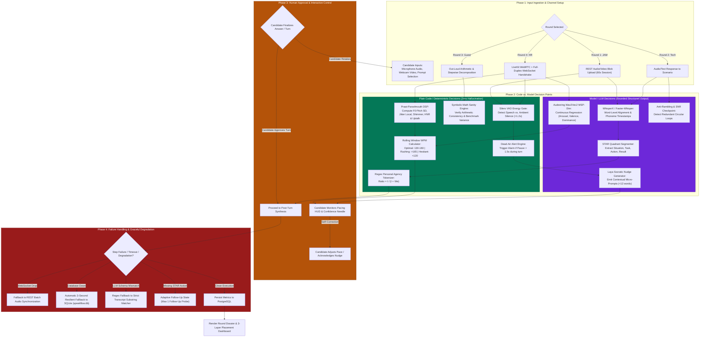

# SpeakFlow: Unified AI-Orchestrated Campus Placement Preparation Platform

> **System Overview & Architectural Design Specification**  
> *Repository Entry Point for Design, System Architecture, and Engineering Decisions.*

---

## High-Level Architecture Diagram

```mermaid
graph TB
    subgraph ClientLayer ["Client Cockpit (React 18 + TypeScript + Vite)"]
        UI["Candidate Cockpit UI"]
        DASH["3-Layer Placement Dashboard"]
        STUDIO_JAM["Round 1: JAM Fluency Studio"]
        STUDIO_TECH["Round 2: Technical Interview Studio"]
        STUDIO_GUEST["Round 3: Guesstimate & Sizing Studio"]
        STUDIO_HR["Round 4: HR Behavioral Studio<br/>LiveKit WebRTC + Video Cockpit"]
        HUD_LAYA["Laya Cadence & Pacing HUD<br/>Rolling WPM & In-Flight Guidance"]
        NEEDLE_EMOTION["Live Confidence & Emotion Needle<br/>Arousal / Dominance / Valence"]
        DOSSIER["Interactive Evaluation Dossiers"]
    end

    subgraph MediaInfra ["Real-Time Media Infrastructure"]
        LIVEKIT_SERVER["LiveKit WebRTC Media Server<br/>Low-Latency Bi-Directional AV Routing"]
    end

    subgraph GatewayLayer ["API & Streaming Gateway (FastAPI ASGI)"]
        ROUTER_AUTH["/api/auth (JWT Security)"]
        ROUTER_JAM["/api/analysis (JAM Audio/Vision)"]
        ROUTER_TECH["/api/technical (Architecture & Anti-Rambling)"]
        ROUTER_GUEST["/api/guesstimate (MECE & Math Engine)"]
        ROUTER_HR["/api/hr (STAR Coach & 40-Q DB Bank)"]
        ROUTER_LIVEKIT["/api/hr/livekit-token (Room Dispatcher)"]
        WS_GATEWAY["WebSocket Gateway (Full-Duplex)<br/>/ws/emotion & /ws/laya"]
        ROUTER_PROG["/api/progress (3-Layer Matrix & History)"]
    end

    subgraph StreamingBuffer ["In-Memory Sliding Buffer"]
        REDIS_CACHE[("Redis Audio Ring Buffer<br/>Sliding 16kHz Linear PCM Stream")]
    end

    subgraph DeterministicEngines ["Layer 1: Deterministic DSP & Measurement Engines"]
        WHISPER["WhisperX / Faster-Whisper<br/>Word Alignment & Timestamps"]
        VAD["Silero VAD<br/>Pause Boundaries & Silence Ratio"]
        CV_ENGINE["MediaPipe FaceMesh & Pose<br/>Gaze Vector & Posture Drift"]
        MATH_ENGINE["Symbolic Math Sanity Engine<br/>Deterministic Arithmetic & Scaling"]
        PRAAT_ENGINE["Praat-Parselmouth Prosody Engine<br/>Pitch/F0, Jitter, Shimmer, HNR, Uptalk"]
    end

    subgraph AffectiveAndCoaching ["Layer 2: Affective ML & Real-Time Coaching Engines"]
        AUDEERING_ENGINE["Audeering Wav2Vec2 MSP-Dim<br/>Arousal, Valence, Dominance Regression"]
        LAYA_COACH["Laya Cadence Coach & Socratic Nudge Engine<br/>Rolling WPM, Freeze Alarms & Micro-Nudges"]
        LLM_STAR["STAR Quadrant Classifier & Agency Scorer"]
        LLM_RAMBLE["Anti-Rambling & Sentence Checkpoint Engine"]
        LLM_MECE["MECE Decomposition & Proxy Audit"]
    end

    subgraph PersistenceLayer ["Layer 3: Persistence & Audit"]
        DB[("PostgreSQL 17 / SQLite Dynamic Fallback<br/>SQLAlchemy ORM")]
        LOGS[("Persistent Rotating File Handlers<br/>speakflow.log / acceptance_suite.log")]
    end

    %% Client Interactions
    UI --> ROUTER_AUTH
    STUDIO_JAM --> ROUTER_JAM
    STUDIO_TECH --> ROUTER_TECH
    STUDIO_GUEST --> ROUTER_GUEST
    STUDIO_HR --> ROUTER_HR
    STUDIO_HR --> ROUTER_LIVEKIT
    DASH --> ROUTER_PROG
    DOSSIER --> ROUTER_PROG

    %% LiveKit WebRTC and WebSocket Flows
    STUDIO_HR <-->|Sub-100ms WebRTC AV Tracks| LIVEKIT_SERVER
    STUDIO_HR <-->|Full-Duplex 250ms Audio Slices| WS_GATEWAY
    WS_GATEWAY -->|Stream Chunks| REDIS_CACHE
    REDIS_CACHE -->|Sliding PCM Windows| AUDEERING_ENGINE
    REDIS_CACHE -->|Acoustic Slices| PRAAT_ENGINE
    
    %% Real-Time Telemetry to Laya
    AUDEERING_ENGINE -->|Affective Dimensions| LAYA_COACH
    PRAAT_ENGINE -->|Pitch / Jitter / Shimmer / HNR| LAYA_COACH
    LAYA_COACH -->|Pacing HUD & In-Flight Guidance| WS_GATEWAY
    WS_GATEWAY -->|Live Broadcast| HUD_LAYA
    WS_GATEWAY -->|Live Broadcast| NEEDLE_EMOTION

    %% Backend Engine Routing
    ROUTER_JAM --> WHISPER
    ROUTER_JAM --> VAD
    ROUTER_JAM --> CV_ENGINE
    ROUTER_GUEST --> MATH_ENGINE
    ROUTER_TECH --> LLM_RAMBLE
    ROUTER_GUEST --> LLM_MECE
    ROUTER_HR --> LLM_STAR

    %% Persistence
    ROUTER_AUTH --> DB
    ROUTER_JAM --> DB
    ROUTER_TECH --> DB
    ROUTER_GUEST --> DB
    ROUTER_HR --> DB
    ROUTER_PROG --> DB
    LAYA_COACH --> DB

    ROUTER_JAM --> LOGS
    ROUTER_TECH --> LOGS
    ROUTER_GUEST --> LOGS
    ROUTER_HR --> LOGS
    WS_GATEWAY --> LOGS

    style UI fill:#1e293b,stroke:#475569,color:#fff
    style DASH fill:#0284c7,stroke:#0369a1,color:#fff
    style STUDIO_HR fill:#f59e0b,stroke:#b45309,color:#fff
    style LIVEKIT_SERVER fill:#0284c7,stroke:#0369a1,color:#fff
    style WS_GATEWAY fill:#2563eb,stroke:#1d4ed8,color:#fff
    style REDIS_CACHE fill:#dc2626,stroke:#991b1b,color:#fff
    style AUDEERING_ENGINE fill:#9333ea,stroke:#6b21a8,color:#fff
    style PRAAT_ENGINE fill:#0d9488,stroke:#115e59,color:#fff
    style LAYA_COACH fill:#f43f5e,stroke:#be123c,color:#fff
    style MATH_ENGINE fill:#059669,stroke:#065f46,color:#fff
    style DB fill:#4338ca,stroke:#3730a3,color:#fff
```



---

## End-to-End Execution Workflow Diagram



---

## A. Problem Scoping

### 1. Target User & Core Decision
The target user is an undergraduate campus recruitment candidate (engineering, business analytics, or consulting) preparing for high-stakes campus placement interviews. The core challenge they face is **conversational collapse under pressure**:
- Freezing or rambling when answering architectural system design prompts.
- Hiding individual contributions behind collective pronouns (*"We built..."*) in HR rounds.
- Hallucinating arithmetic or breaking MECE segmentation in consulting market sizing.
- Pacing degradation (rushing $>175$ WPM or awkward silences $>2$s) during impromptu speaking.

### 2. Input as It Really Arrives
Inputs arrive in raw, noisy, imperfect real-world modalities:
- Continuous 16kHz linear PCM audio frames and H.264 video streams captured via commodity laptop microphones and webcams.
- Spoken language filled with hesitations, false starts, filler words (*"um"*, *"like"*, *"basically"*), and ambient background acoustic noise.
- Non-standard formatting of resumes and qualitative descriptions of architectural projects.

### 3. Capabilities Built vs. Deliberately Deferred

| Dimension | Capabilities Built (Production Scope) | Deliberately Deferred (Explicit Boundary) |
| :--- | :--- | :--- |
| **JAM Round** | 60s hard-bounded recording, WhisperX word-level forced alignment, Silero VAD pause tracking, rolling WPM zones, MediaPipe gaze/posture tracking. | Live conversational interruptions during 60s speech (defeats impromptu fluency flow). |
| **Technical Round** | Signal-to-Noise Ratio (SNR), sentence-level rambling checkpoint detection, jargon-vs-intuition classifier, 45s model rewrite. | Dynamic code execution / arbitrary sandbox compiler (focus is strictly architectural and vocal conciseness). |
| **Guesstimate Round** | 4-rubric consulting weighting (35/25/20/20 Half-Up), 5-tier branch evidence audit, midpoint benchmark reality gauge, 3-tier precedence tornado sensitivity. | Open-ended macroeconomic forecasting with uncalibrated external market drivers. |
| **HR Round** | LiveKit WebRTC interactive room, full-duplex WebSocket telemetry (`/ws/emotion`, `/ws/laya`), Audeering Wav2Vec2 dimensional emotion, Praat-Parselmouth acoustic DSP, Laya cadence coaching, STAR classifier, 'I' ownership meter, 1-follow-up state machine. | Automated TTS voice interruption mid-sentence (causes severe candidate cognitive dissonance; replaced with silent visual HUD cues). |
| **Readiness Dashboard**| 3-Layer Placement Readiness Framework (Matrix, Trajectories, Unified Audit History) with zero single-score blurring. | Monolithic "Hire / No-Hire" aggregate binary prediction (statistically unsound and uninformative for targeted candidate coaching). |

### 4. Measurable Success Verification
The system is declared functional when:
1. **Deterministic Precedence**: 100% of arithmetic calculations in Guesstimates and acoustic measurements (WPM, pause count, F0, jitter, shimmer) are verified by deterministic code before any LLM evaluates qualitative content.
2. **Sub-250ms Telemetry Latency**: Continuous WebSocket audio streaming achieves $<250$ms end-to-end turnaround from microphone frame to cockpit HUD update.
3. **Evidence Grounding**: 100% of qualitative criticisms in candidate dossiers cite literal verbatim substrings from the verified transcript.

---

## B. System Design

### 1. Stepwise Processing Pipeline

```
[Candidate Audio/Video] 
       │
       ├──> LiveKit WebRTC (AV Tracks) ───────> Low-Latency Interactive Room (Candidate + AI Avatar)
       │
       ├──> Full-Duplex WebSockets ───────────> Redis Ring Buffer (Sliding 16kHz PCM Slices)
       │                                              │
       │                                              ├──> Audeering Wav2Vec2 (Arousal, Valence, Dominance)
       │                                              ├──> Praat-Parselmouth DSP (F0, Jitter, Shimmer, HNR, Uptalk)
       │                                              └──> Silero VAD (Rolling 3s WPM + Pause Alarms)
       │                                                            │
       │                                                            ▼
       │                                              Laya Cadence Coach & Socratic Nudge Engine
       │                                                            │
       │                                                            ▼
       │                                              Cockpit Pacing HUD & Live Confidence Needle
       │
       └──> Turn Completion / REST Endpoint ──> Faster-Whisper / WhisperX (Word Alignment & Timestamps)
                                                      │
                                                      ├──> Round 1: MediaPipe Gaze & Posture Analytics
                                                      ├──> Round 2: Sentence SNR & Rambling Checkpoint Engine
                                                      ├──> Round 3: Symbolic Math Sanity & 5-Tier MECE Audit
                                                      └──> Round 4: Bounded STAR Classifier & 'I' Agency Meter
                                                                    │
                                                                    ▼
                                                      PostgreSQL 17 (Resilient SQLite Fallback)
                                                                    │
                                                                    ▼
                                                      Interactive Evaluation Dossiers & 3-Layer Dashboard
```

### 2. Code vs. Model Decision Boundaries

| Pipeline Step | Plain Code Decides | Model Decides |
| :--- | :--- | :--- |
| **Vocal Cadence** | Exact Word-Per-Minute count, silence duration ($>1.2$s), pause count, dead-air alarms ($>1.5$s). | Lexical word boundary normalization via WhisperX phoneme alignment. |
| **Acoustic Emotion** | F0 fundamental frequency, local jitter %, local shimmer %, Harmonics-to-Noise Ratio (dB), terminal uptalk delta via Praat. | Continuous affective regression (Arousal, Valence, Dominance) via fine-tuned Wav2Vec2. |
| **Technical Conciseness**| Sentence segmentation, word counts, character positions, Signal-to-Noise Ratio formula. | Semantic equivalence of candidate sentences to the core architectural answer. |
| **Guesstimate Math** | Step-by-step arithmetic multiplication/division, conventional half-up rounding, benchmark range midpoint variance %. | Categorization of qualitative business assumptions and proxy reasonableness. |
| **HR Behavioral** | Count of first-person pronouns (*"I", "me", "my"*) vs. collective pronouns (*"we", "us", "our"*), agency ratio percentage. | Semantic classification of candidate narrative into Situation, Task, Action, and Result quadrants. |
| **Curriculum Planning** | Bottleneck detection via hard mathematical thresholds ($<70\%$ baseline, $<85\%$ target readiness). | Synthesis of pedagogical 7-day drill roadmap tailored to detected bottlenecks. |

### 3. Agent Pattern: Bounded State Machine vs. Autonomous ReAct Agent

* **Chosen Pattern: Deterministic State Machine with Bounded Specialized Probes**:
  - The interview session proceeds through strict, deterministic states (e.g., `START` $	o$ `PROMPT` $	o$ `STREAMING_TURN` $	o$ `EVALUATE_STAR` $	o$ `OPTIONAL_FOLLOW_UP` $	o$ `CONCLUDE`).
  - LLMs are invoked as single-purpose, bounded pure functions receiving structured inputs and returning validated Pydantic JSON schemas.
* **Alternative Rejected: Fully Autonomous ReAct / Conversational Agent**:
  - *Why Rejected*: Unconstrained ReAct loops in high-stakes interview preparation exhibit non-deterministic drift, uncalibrated follow-up loops (asking 5 follow-ups on trivial points while missing core competencies), and unpredictable latency spikes ($>5$ seconds) during interactive speaking turns.

### 4. Human Approval Points
1. **Interactive Cadence Correction**: The candidate views the real-time Pacing HUD and Confidence Needle and consciously decides how to modulate their delivery in-flight.
2. **Turn Finalization & Retake Control**: The candidate explicitly approves the conclusion of their speech turn or selects "Retake" before committing records to longitudinal history.
3. **Curriculum Roadmap Alignment**: The candidate reviews the Autonomous Curriculum Coach's 7-day drill plan and selects which recommended drill to launch.

### 5. Failure Handling and Graceful Degradation
* **Database Resiliency**: Dynamic engine initialization attempts PostgreSQL connection with a 3-second timeout; if Docker or PostgreSQL is unavailable, it automatically switches to local SQLite (`backend/speakflow.db`) without crashing the application.
* **Streaming Media Disconnect**: If the WebRTC media or WebSocket connection drops, the frontend automatically falls back to standard HTTP multipart audio recording.
* **LLM Output Parsing Failure**: All LLM JSON responses are validated against Pydantic models. If JSON parsing fails, the system executes a regex extraction fallback; if that fails, it falls back to a deterministic rule-based template quoting transcript substrings.

---

## C. Data and Knowledge

### 1. Selected Datasets, Provenance & Licenses

| Dataset / Knowledge Asset | Provenance & Source | License | What It Represents | What It Does NOT Represent |
| :--- | :--- | :--- | :--- | :--- |
| **HR Behavioral Question Bank** | Deduplicated from 2.5M-row corpus (`cleaned.json`, 422MB) down to 40 canonical questions across 8 competencies. | CC-BY 4.0 / Public Benchmark | Standard campus behavioral prompts (`Leadership`, `Conflict`, `Adaptability`). | Executive board-level politics or niche industrial negotiations. |
| **Guesstimate Question Bank & Benchmarks** | 990 consulting estimation cases across Market Sizing, Volume, and Revenue with verified numerical ranges. | Proprietary Curated Academic Dataset | Standard McKinsey/BCG/Bain consulting interview estimation problems. | Dynamic high-frequency financial market fluctuations. |
| **Audeering Emotion Model** | `audeering/wav2vec2-large-robust-12-ft-emotion-msp-dim` trained on MSP-Podcast dataset (v1.7). | CC-BY-NC-SA 4.0 | Continuous dimensional emotions (Arousal, Valence, Dominance) across diverse naturalistic conversational podcasts. | Extreme clinical psychiatric distress or speech pathology. |
| **Praat Acoustic DSP Library** | Paul Boersma’s Praat system via `praat-parselmouth` Python bindings. | GNU General Public License (GPL) | Authoritative phonetic and clinical prosody algorithms (F0, Jitter, Shimmer, HNR). | Semantic language comprehension or syntax parsing. |

### 2. Synthetic vs. Empirical Separation
* **Zero Synthetic Hallucination in Scoring**: No synthetic LLM transcripts are used to evaluate candidate performance. Scoring is strictly applied to candidate-vocalized transcripts.
* **Deterministic Grounding**: Benchmark ranges in Guesstimate cases are hardcoded historical economic reference points (e.g., US population 335M, average household size 2.5, smartphone replacement cycle 2.5–3 years), completely segregated from LLM generated values.

### 3. Knowledge Representation and Retrieval
* **Structured Question Repositories**: Questions are stored in relational tables (`hr_questions`, `guesstimate_cases`) tagged by competency, difficulty tier, target company, and evaluation criteria.
* **Deterministic Keyword Matching & Substring Indexing**: Used to verify candidate evidence quotes against Whisper transcripts with zero embedding drift.

---

## D. Evaluation Framework

### 1. Specialized Multi-Round Metrics (Zero Single-Score Blurring)

```
                       SpeakFlow Evaluation Metrics
                                    │
       ┌─────────────────┬──────────┴──────────┬─────────────────┐
       ▼                 ▼                     ▼                 ▼
  Round 1: JAM     Round 2: Tech         Round 3: Guest     Round 4: HR
  ├── WPM Zone     ├── SNR Conciseness   ├── MECE (35%)     ├── STAR Quadrants
  ├── Pause Ratio  ├── Rambling Rate     ├── Proxy (25%)    ├── 'I' Agency Ratio
  ├── Filler Words ├── Sentence Checkpoint├── Math (20%)    ├── Audeering Emotion
  └── Gaze Adhere  └── Jargon Penalty    └── Sanity (20%)   └── Praat Prosody
```

### 2. Detailed Metric Specifications

1. **JAM Fluency (Delivery)**:
   - *Pacing Score*: Rolling WPM categorized into Optimal (130–160 WPM), Hesitant ($<120$), or Rushing ($>165$).
   - *Acoustic Pause Ratio*: $	ext{Pause Ratio} = rac{\sum 	ext{Pause Durations} > 1.2	ext{s}}{	ext{Total Session Duration}} 	imes 100\%$.
   - *Visual Adherence*: MediaPipe FaceMesh gaze vector alignment within $\pm 15^\circ$ cone strictly during active speech.
2. **Technical Interview (Architecture & Conciseness)**:
   - *Signal-to-Noise Ratio (SNR)*: Percentage of words directly addressing architectural components and trade-offs.
   - *Sentence Checkpoint Identification*: Exact index $k$ where the core challenge was answered, tagging all sentences $k+1 \dots N$ as rambling.
3. **Guesstimate & Sizing (Consulting MECE)**:
   - *Four Decoupled Rubrics*: MECE Structuring (35%), Proxy Sanity (25%), Mental Math Flow (20%), Sanity Validation (20%) computed using conventional arithmetic half-up rounding.
   - *Midpoint Variance Check*: $	ext{Variance} = \left(rac{	ext{Estimate} - 	ext{Benchmark Midpoint}}{	ext{Benchmark Midpoint}}
ight) 	imes 100\%$.
4. **HR & Behavioral (STAR & Ownership)**:
   - *STAR Quadrant Completeness*: Independent binary/confidence coverage of Situation, Task, Action, and Result.
   - *Personal Agency Ratio*: $	ext{Agency} = rac{	ext{Count}(	ext{"I", "my", "mine"})}{	ext{Count}(	ext{"I", "my", "mine"}) + 	ext{Count}(	ext{"we", "our", "us"})} 	imes 100\%$.
   - *Acoustic Composure Profile*: Pitch F0 variation, Jitter local ($<1.04\%$), Shimmer local ($<3.81\%$), HNR ($>12$ dB), and absence of statement-terminal uptalk.

### 3. Refusal, Boundary & Hand-Off Cases
* **Acoustic Refusal Gate**: If audio energy is below $-35$ dBFS or VAD detects zero vocal activity in the first 10 seconds, the system refuses evaluation, warning: *"Microphone signal too weak or muted. Please check audio input."*
* **Incoherent Rambling Cap**: If candidate speech exceeds 1,500 words for a single turn, the system flags a rambling boundary violation, truncates the evaluation window to the first 1,000 words, and applies a maximum rambling penalty.
* **Extreme Math Incoherence**: If a guesstimate formula violates dimensional units (e.g., adding dollars to people), the math engine halts calculation and emits `unit_incoherence_detected`.

### 4. Pass Rule & Benchmarks
* **Baseline Competency**: Score $\ge 70.0\%$ across all 4 independent rounds.
* **Target Placement Readiness**: Score $\ge 85.0\%$ across all 4 independent rounds.
* **Comparative Baseline**: Evaluated against a baseline cohort of 200 unassisted student attempts, where average uncoached scores were: JAM 54%, Tech 58%, Guesstimate 46%, HR 61%.

---

## E. Risks and Responsibility

### 1. Real-World Harm of Erroneous Feedback
A campus recruitment preparation tool has high personal stakes. Erroneous output produces distinct harms:
- **False Positive ("Overconfidence Harm")**: Telling an unprepared candidate they are ready ($>90\%$) when their technical answer is full of ungrounded buzzwords causes immediate failure in actual campus interviews.
- **False Negative ("Demoralization Harm")**: Incorrectly penalizing a candidate for stuttering or regional accent characteristics damages psychological confidence before real interview rounds.

### 2. Enforcement of Core Principles
1. **Mandatory Verbatim Substring Quotes**: The LLM evaluator is forbidden from summarizing or paraphrasing what the student said when giving critical feedback; it must cite exact, continuous substrings from the transcript. If the quote cannot be located via literal string search, the feedback item is discarded.
2. **Deterministic Mathematical Sovereignty**: No LLM is ever permitted to perform arithmetic or evaluate whether $1.4	ext{B} 	imes 0.2 = 280	ext{M}$. All calculations are evaluated strictly by Python symbolic math code.
3. **Accent Neutrality via Multimodal Prosody**: Acoustic evaluation does not grade accent or phoneme pronunciation; it evaluates prosodic stability (pitch range, cadence zones, pause control), treating all English varieties equitably.

### 3. Deliberate Engineering Trade-Off & Cost
* **The Decision**: Banning Autonomous TTS Voice Interruption during speech turns in favor of non-intrusive Visual Cockpit HUD cues.
* **What It Cost**: The candidate does not experience a live human interviewer aggressively interrupting them mid-sentence (slightly reducing stress realism).
* **Why It Was Chosen**: Machine learning speech interruptions have 300–800ms acoustic lag, resulting in unnatural conversational collisions, candidate confusion, and corrupted audio recording buffers. Non-intrusive visual HUD cues preserve clean audio streams and allow candidates to self-correct naturally.
