# Unified Implementation Approach: SpeakFlow 4-Round Campus Recruitment Preparation Platform

## 1. Introduction to the Modules

SpeakFlow is a comprehensive, AI-orchestrated campus placement interview preparation platform. The platform prepares engineering and business candidates for the rigorous, multi-stage recruitment pipelines typical of top technology firms, investment banks, and management consultancies.

Instead of generic conversational chatbots, SpeakFlow partitions interview preparation into **four specialized evaluation rounds** and unifies them under a **3-Layer Placement Readiness Dashboard**. Every module adheres to a core engineering philosophy: **predictable state machines, objective deterministic measurements prior to subjective scoring, explainable evidence-backed feedback, and zero artificial cross-round metric blurring**.

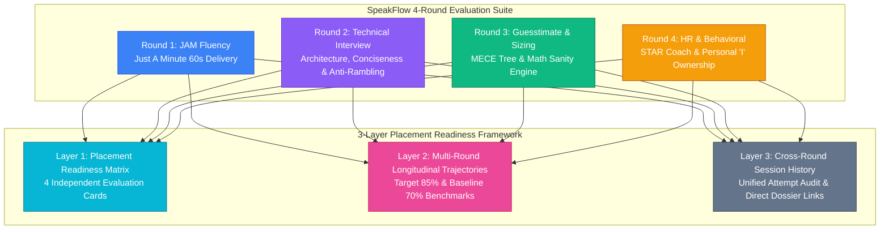

### Round 1: JAM (Just A Minute) Fluency Module
* **Core Function:** Trains candidates to deliver concise, compelling 60-second impromptu speeches on randomized or curated topics.
* **Evaluation Focus:** Objective delivery metrics (WPM, pacing zones, filler words, pause duration, silence ratio) coupled with computer-vision gaze tracking (eye contact adherence, head stability) and structural coherence (opening hook, progression, conclusion).
* **Key Constraint:** Objective vocal and visual telemetry is computed deterministically via Python, WhisperX, Silero VAD, and OpenCV; LLMs are restricted strictly to analyzing verified transcript text for topical relevance.

### Round 2: Technical Interview Module
* **Core Function:** Simulates role-specific engineering rounds (Senior Backend, Frontend, Fullstack, Machine Learning, DevOps, Systems Architecture).
* **Evaluation Focus:** Architectural soundness, system trade-offs (CAP theorem, caching, latency), **Signal-to-Noise Ratio (SNR) / Conciseness**, **Anti-Rambling Penalties**, and **Jargon vs. Intuitive Understanding**.
* **Key Constraint:** Enforces sentence-level analysis identifying the exact checkpoint where the candidate answered the question and began rambling in circles.

### Round 3: Guesstimate & Market Sizing Module
* **Core Function:** Evaluates quantitative estimation, market sizing, and capacity estimation problems across structured difficulty levels.
* **Evaluation Focus:** **MECE (Mutually Exclusive, Collectively Exhaustive) Tree Decomposition**, **Step-by-Step Mathematical Verification**, and **Proxy/Benchmark Realism**.
* **Key Constraint:** Arithmetic consistency is validated via a deterministic symbolic math engine, completely preventing LLM hallucination of numerical operations.

### Round 4: HR & Behavioral Interview Module
* **Core Function:** Multi-turn adaptive mock interviews using a deduplicated 40-question database bank across 8 behavioral categories (`Adaptability`, `Conflict Resolution`, `Leadership`, `Team Collaboration`, `Culture Fit`, `Motivation`, `Career Goals`, `Work Style`).
* **Evaluation Focus:** **STAR Method Completeness** (Situation, Task, Action, Result), **Personal Ownership ("I" vs. "We" Ratio)**, and **Concrete Specificity & Measurable Business Impact**.
* **Key Constraint:** Enforces an adaptive state machine allowing at most one targeted follow-up question when an essential STAR quadrant is absent.

---

## 2. Unified High-Level Architecture

SpeakFlow employs a high-performance, unified pipeline architecture. The backend acts as the deterministic source of truth, coordinating specialized speech models, computer vision engines, database repositories, and structured LLM evaluators.

```mermaid
graph TB
    subgraph ClientLayer ["Client Layer (React 18 + TypeScript + Vite)"]
        UI["Candidate Cockpit"]
        DASH["3-Layer Placement Dashboard"]
        STUDIO_JAM["JAM 60s Studio"]
        STUDIO_TECH["Technical Studio"]
        STUDIO_GUEST["Guesstimate Studio"]
        STUDIO_HR["HR Behavioral Studio"]
        DOSSIER["Interactive Evaluation Dossiers"]
    end

    subgraph APIGateway ["API Gateway & Controller Layer (FastAPI ASGI)"]
        ROUTER_AUTH["/api/auth (JWT Security)"]
        ROUTER_JAM["/api/analysis (JAM Audio/Vision)"]
        ROUTER_TECH["/api/technical (Architecture & Anti-Rambling)"]
        ROUTER_GUEST["/api/guesstimate (MECE & Math Engine)"]
        ROUTER_HR["/api/hr (STAR Coach & 40-Question DB Bank)"]
        ROUTER_PROG["/api/progress (3-Layer Matrix & Timelines)"]
    end

    subgraph TelemetryEngines ["Deterministic Measurement Engines (Layer 1)"]
        WHISPER["WhisperX / Faster-Whisper<br/>Word-Level Alignment & Timestamps"]
        VAD["Silero Voice Activity Detection<br/>Silence & Pause Extraction"]
        CV_ENGINE["OpenCV / MediaPipe<br/>Gaze Vector & Posture Tracking"]
        MATH_ENGINE["Symbolic Math Sanity Engine<br/>Arithmetic & Order-of-Magnitude Checks"]
    end

    subgraph LLMEvaluators ["LLM Evaluator & Reasoning Engines (Layer 2)"]
        LLM_STAR["STAR Quadrant Classifier & Agency Scorer"]
        LLM_RAMBLE["Anti-Rambling & Sentence Checkpoint Detector"]
        LLM_JARGON["Jargon vs. Intuitive Concept Classifier"]
        LLM_MECE["MECE Framework Completeness Evaluator"]
    end

    subgraph PersistenceLayer ["Persistence & Audit Layer"]
        DB[("PostgreSQL 17 / SQLite Dynamic Fallback<br/>SQLAlchemy ORM")]
        LOGS[("Persistent Rotating File Handlers<br/>speakflow.log / error.log / acceptance_suite.log")]
    end

    UI --> ROUTER_AUTH
    STUDIO_JAM --> ROUTER_JAM
    STUDIO_TECH --> ROUTER_TECH
    STUDIO_GUEST --> ROUTER_GUEST
    STUDIO_HR --> ROUTER_HR
    DASH --> ROUTER_PROG
    DOSSIER --> ROUTER_PROG

    ROUTER_JAM --> WHISPER
    ROUTER_JAM --> VAD
    ROUTER_JAM --> CV_ENGINE
    ROUTER_GUEST --> MATH_ENGINE

    ROUTER_TECH --> LLM_RAMBLE
    ROUTER_TECH --> LLM_JARGON
    ROUTER_GUEST --> LLM_MECE
    ROUTER_HR --> LLM_STAR

    ROUTER_AUTH --> DB
    ROUTER_JAM --> DB
    ROUTER_TECH --> DB
    ROUTER_GUEST --> DB
    ROUTER_HR --> DB
    ROUTER_PROG --> DB

    ROUTER_JAM --> LOGS
    ROUTER_TECH --> LOGS
    ROUTER_GUEST --> LOGS
    ROUTER_HR --> LOGS

    style UI fill:#1e293b,stroke:#475569,color:#fff
    style DASH fill:#0284c7,stroke:#0369a1,color:#fff
    style ROUTER_JAM fill:#3b82f6,stroke:#1d4ed8,color:#fff
    style ROUTER_TECH fill:#8b5cf6,stroke:#6d28d9,color:#fff
    style ROUTER_GUEST fill:#10b981,stroke:#047857,color:#fff
    style ROUTER_HR fill:#f59e0b,stroke:#b45309,color:#fff
    style WHISPER fill:#0d9488,stroke:#115e59,color:#fff
    style MATH_ENGINE fill:#059669,stroke:#065f46,color:#fff
    style DB fill:#4338ca,stroke:#3730a3,color:#fff
    style LOGS fill:#334155,stroke:#1e293b,color:#fff
```

---

## 3. Component Responsibilities

### Layer 1: Objective Telemetry & Deterministic Engines
* **Audio Telemetry:** Ingests WebM/WAV audio, performs 16kHz mono normalization, runs **WhisperX** for word-level forced alignment, and calculates exact Word-Per-Minute (WPM) curves.
* **Acoustic Pause Detection:** Deploys **Silero VAD** to detect acoustic energy boundaries, distinguishing purposeful rhetorical pauses from awkward hesitation without relying on text heuristics.
* **Computer Vision Tracking:** Processes webcam frames via **OpenCV / MediaPipe FaceMesh** to track gaze vectors, eye contact percentages, and head pose stability strictly during vocalized speech.
* **Deterministic Math Validation:** Evaluates quantitative formulas in guesstimate trees using symbolic computation, verifying arithmetic calculations against user-declared assumptions.

### Layer 2: LLM Reasoning & Evaluator Engines
* **Grounded Substring Extraction:** All qualitative feedback must quote literal substrings from the candidate's transcript. Hallucinated evidence is strictly blocked.
* **Anti-Rambling & Conciseness Engine:** Computes signal-to-noise ratios, tags repetitive loops, and identifies the exact sentence index where the candidate answered the prompt and could have concluded.
* **Jargon vs. Intuition Classifier:** Detects textbook definitions recited without mechanical intuition; rewards concrete real-world metaphors and implementation trade-offs.
* **STAR & Ownership Analyzer:** Classifies answer segments into Situation, Task, Action, and Result; measures the ratio of first-person ("I") vs. plural ("We") pronouns.

### Layer 3: FastAPI Backend Orchestrator & State Management
* **Interview State Machine:** Governs round lifecycle transitions (e.g., 60-second hard cutoff for JAM, 1 adaptive follow-up limit for HR).
* **Database Management:** SQLAlchemy models with dynamic engine initialization: targets PostgreSQL in production, with seamless 3-second fallback to SQLite (`speakflow.db`) if Docker is offline.
* **Preparation Target Calibrations:** Calibrates benchmark targets (Baseline 70% / Target 85%) as prep guidelines rather than absolute hiring predictions.
* **Logging System:** Uses Python `RotatingFileHandler` (10 MB, 5 backups) writing to `backend/logs/speakflow.log` and `error.log`.

### Layer 4: 3-Layer Placement Readiness Dashboard
* **Layer 1 (Readiness Matrix):** Four independent round cards displaying specialized metrics (JAM delivery, Tech architecture, Guesstimate MECE, HR behavioral fit) without score-blurring.
* **Layer 2 (Longitudinal Trajectories):** Historical skill trendlines tracking performance against calibrated target thresholds.
* **Layer 3 (Cross-Round Session History):** Chronological log of attempts with direct links to comprehensive dossiers.

---

## 4. Implementation Workflows, Failure Analyses & Feature Innovations

Every module in SpeakFlow evolved through direct iterative discovery. The previous naive approaches failed in realistic recruitment settings; analyzing these failures led to the design of the current features.

---

### A. Round 1: JAM (Just A Minute) Fluency

#### 1. Why the Previous Approach Failed
* **Text-Only Transcription Shortcomings:** Evaluating plain text transcripts discarded crucial vocal signals (pacing, rhythm, filler words, and awkward silences).
* **Averaged WPM Blindspots:** A student speaking at 220 WPM for 20 seconds and then freezing for 40 seconds averaged 73 WPM—appearing "slow" rather than exhibiting severe pacing collapse.
* **Lack of Visual Telemetry:** Transcripts could not show whether candidates read from a script or maintained camera eye contact.
* **Single Metric Blurring:** Merging vocal pace, filler words, and content into one score hid whether the candidate had delivery problems or topical content issues.

#### 2. How the New Features Solved It
* **WhisperX Word-Level Forced Alignment:** Synchronizes every spoken word to exact millisecond timestamps.
* **Silero VAD Silence Engine:** Detects pauses (>1.2s) and micro-hesitations independently of ambient background noise.
* **Pacing Zones:** Automatically categorizes speech into *Rushing (>165 WPM)*, *Optimal (130–160 WPM)*, and *Hesitant (<120 WPM)*.
* **MediaPipe Gaze & Posture Tracking:** Computes eye-contact percentage and head-drift vectors strictly during speech segments.
* **Synchronized Audio Dossier:** `/analysis/{id}` visualizes the waveform, filler word markers, and gaze trends on an interactive timeline.

#### 3. Round 1 Workflow Diagram
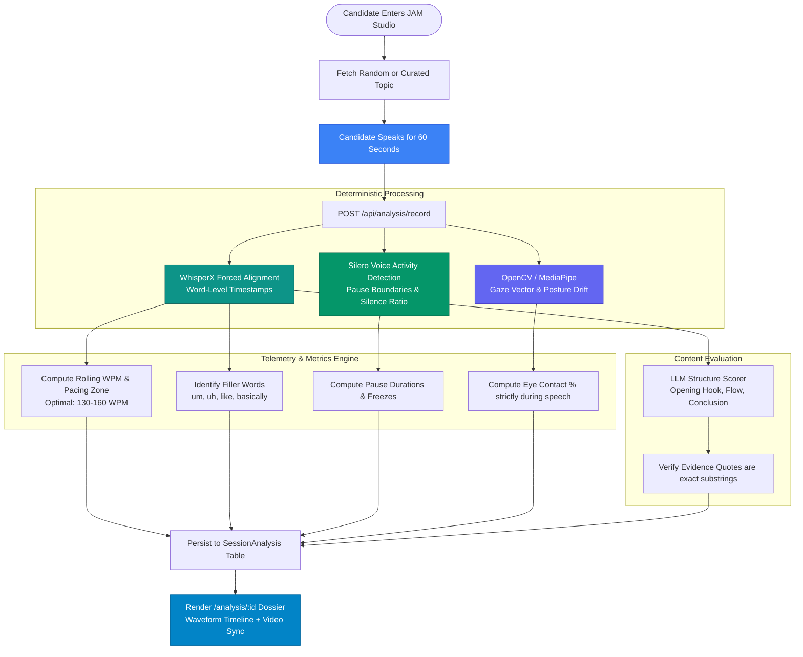

---

### B. Round 2: Technical Interview (Architecture & Conciseness)

#### 1. Why the Previous Approach Failed
* **The "Rambling" Exploitation:** Students often talk in circles when unsure of an architecture answer, hoping keyword repetition will fool the interviewer. Traditional LLM rubrics gave high scores to verbose answers because keywords were present.
* **Jargon Without Intuition:** Candidates memorized textbook definitions (e.g., ACID properties or CAP theorem) without understanding practical application or trade-offs.
* **Monolithic Text Appraisal:** Evaluators scored the entire response as a single block without showing the candidate where they should have concluded.

#### 2. How the New Features Solved It
* **Anti-Rambling Penalty & SNR Metric:** Computes the Signal-to-Noise Ratio (conciseness percentage) and penalizes redundant statements.
* **Sentence-Level Conclusion Checkpoint:** Identifies the exact sentence where the candidate answered the core challenge, highlighting the subsequent rambling sentences in red.
* **Jargon vs. Understanding Classifier:** Flags ungrounded buzzwords; rewards concrete trade-offs (e.g., latency vs. consistency, write-heavy vs. read-heavy caching).
* **Interactive Technical Dossier:** `/technical/report/{id}` renders architecture scores, conciseness metrics, sentence-by-sentence analysis, and an optimized rewrite script.

#### 3. Round 2 Workflow Diagram
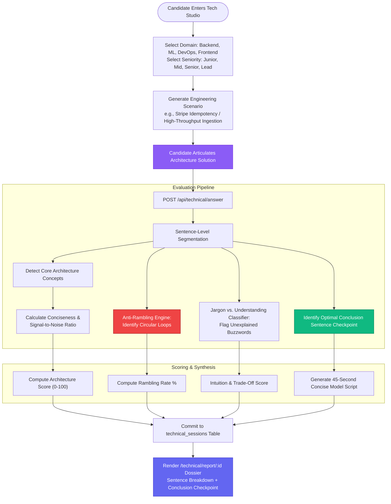

---

### C. Round 3: Guesstimate & Market Sizing (Consulting MECE & Math Sanity Engine)

#### 1. Why the Previous Approach Failed
* **LLM Math Hallucination:** Relying on LLMs to grade quantitative market sizing resulted in hallucinated arithmetic corrections, missing candidate calculation errors, or validating impossible order-of-magnitude estimates.
* **Unstructured Reasoning & The Single-Score Trap:** Evaluating market sizing with a single generic score failed to separate formula decomposition defects from calculation slips or proxy insanity. A candidate could calculate arithmetic cleanly while omitting half the market pool, yet receive an uninformative composite score.
* **Absence of Benchmark Grounding & Unit Incoherence:** Solutions were graded on superficial verbal confidence without checking whether the candidate's final estimate matched verified industry bounds in both numerical scale, geographical territory, and timeframe units (e.g. daily units vs. annual revenue).
* **Naive Inverse-Relationship Keyword Heuristics:** Traditional sensitivity tools flagged words like "cycle" or "replacement" to infer inverse scaling, causing catastrophic errors when formulas were multiplicative or contained multi-variable shifts.

#### 2. How the New Features Solved It
* **Authoritative Four-Rubric Consulting Weighting Architecture:**
  - Evaluates performance across four mathematically decoupled consulting competencies:
    1. **MECE Structuring (35%):** Formula segmentation, non-overlapping boundaries, exhaustive demographic coverage.
    2. **Proxy & Assumption Sanity (25%):** Realistic demographic proxies (e.g., household sizes, income brackets, replacement cycles) defended with explicit business rationale.
    3. **Mental Math & Arithmetic Flow (20%):** Out-loud arithmetic flow, intelligent rounding (80/20, 1.4B, 30%), and zero order-of-magnitude errors.
    4. **Sanity Check & Reality Validation (20%):** Macro benchmarking against GDP/capacity and identification of high-volatility drivers.
  - **Deliberate Rounding Policy:** Employs conventional arithmetic half-up rounding ($\text{val} + 0.5 \to \lfloor \cdot \rfloor$, ensuring $82.5 \to 83$) rather than Python's ties-to-even Banker's rounding.
* **Empirical Range Reality Check Diagnostic:**
  - Compares candidate's final estimate against verified consulting benchmark ranges normalized for identical geography, period, and unit.
  - Computes variance against a documented midpoint reference baseline:
    $$\text{Variance \%} = \left(\frac{\text{Candidate Estimate} - \text{Range Midpoint}}{\text{Range Midpoint}}\right) \times 100\%$$
* **Epistemic Humility in Candidate Branch Evidence Audit:**
  - Audits candidate branches against a 5-tier status enum with literal transcript evidence:
    - 🟢 `supported_mece`: Validated non-overlapping segment.
    - 🔴 `confirmed_overlap`: Explicit double counting detected.
    - 🟠 `omitted_segment`: Significant market sub-segment neglected.
    - 🟡 `unsupported_proxy`: Numerical assumption made without real-world justification.
    - ⚪ `unclear_evidence`: Transcript ambiguous; marked unclear rather than making unsupported assumptions.
* **Direction-Aware Deterministic Sensitivity Engine with 3-Tier Precedence:**
  - Eliminates naive keyword traps by enforcing a strict 3-tier precedence order:
    1. **Tier 1 (Validated Formula Structure & Isolated Variable Roles):** Analyzes the algebraic formula. If the driver is an isolated divisor in a pure division model (e.g. $E = H / R$), validates strictly as `inverse_denominator` ($E \propto 1/D$). If purely multiplicative, validates strictly as `direct_multiplier` ($E \propto D$), explicitly overriding keywords like "cycle". If the formula contains additive offsets (e.g. $E = (H \cdot P)/R + F$), ratio scaling is mathematically invalid; the ambiguity guard immediately holds the simulation and emits `insufficient_formula_articulation` rather than generating misleading numbers.
    2. **Tier 2 (LLM Role Cross-Validation):** When formulas are stated informally, cross-validates explicit `variable_role` (`denominator_divisor` vs. `numerator_factor`) against transcript reasoning.
    3. **Tier 3 (Keyword Fallback with Ambiguity Guard):** Division keywords act strictly as a fallback; if any ambiguity or multi-variable interplay remains, simulation is withheld to safeguard diagnostic integrity.
* **Multi-Driver Sensitivity Ranking (Tornado Comparison):**
  - Isolates primary (volume) and secondary (unit economics) drivers, computing conservative floor and aggressive ceiling bounds side-by-side to highlight where the candidate must invest 80% of their interview defense.

#### 3. Round 3 Workflow Diagram
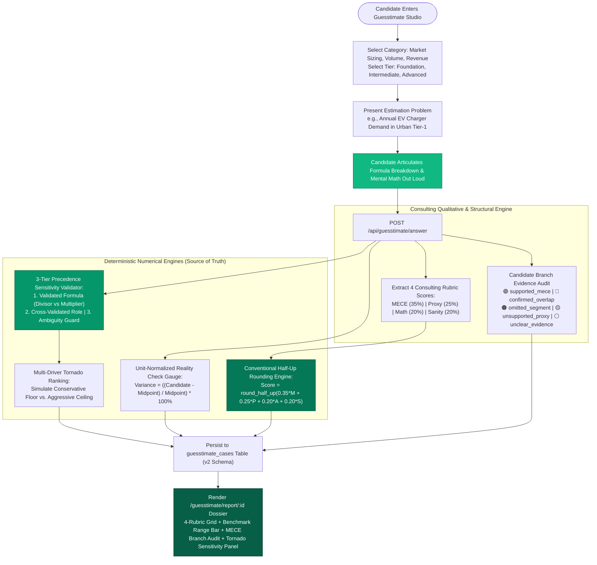

---

### D. Round 4: HR & Behavioral Interview (STAR Coach & Personal Ownership)

#### 1. Why the Previous Approach Failed
* **The "We" Dispersion Trap:** Candidates habitually answered behavioral prompts using passive plural pronouns ("We decided...", "Our team resolved..."), preventing interviewers from assessing individual contribution.
* **Absence of Measurable Results:** Answers frequently omitted quantifiable business outcomes, offering vague platitudes like "Everything went smoothly."
* **Dataset Bloat & Question Redundancy:** A raw dataset of 2.5 million rows (`cleaned.json`, 422 MB) contained only 40 unique canonical questions repeated ~62,500 times each, causing memory bloat and unstructured question delivery.
* **Rigid Static Scripts:** Static questionnaires lacked adaptive pressure to follow up when candidates omitted critical STAR components.

#### 2. How the New Features Solved It
* **Deduplicated 40-Question Database Bank:** Extracted and deduplicated 40 canonical questions across 8 core competencies (`Adaptability`, `Conflict Resolution`, `Leadership`, `Team Collaboration`, `Culture Fit`, `Motivation`, `Career Goals`, `Work Style`) with seeded rubrics in `hr_questions`.
* **Personal Ownership ("I" vs. "We" Ratio):** Measures the ratio of first-person singular action statements against collective phrasing to verify candidate agency.
* **STAR Quadrant Classifier:** Evaluates Situation, Task, Action, and Result coverage independently from qualitative delivery.
* **Adaptive Single Follow-up State Machine:** Dynamically probes missing STAR elements with at most one targeted follow-up question per main prompt.
* **Behavioral Dossier:** `/hr/report/{id}` renders the STAR quadrant breakdown, personal agency score, green/red flag feedback, and an illustrative star response script.

#### 3. Round 4 Workflow Diagram
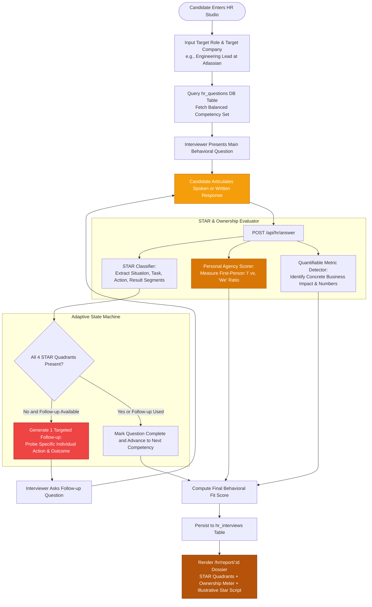

---

### E. 3-Layer Unified Placement Readiness Dashboard

#### 1. Why the Previous Approach Failed
* **The Single-Score Fallacy:** Attempting to compress vocal fluency, architectural design, market sizing, and behavioral fitness into a single composite score obscured critical candidate weaknesses.
* **Fragmented Round Silos:** Candidates had to manually jump between disconnected round pages with no unified placement preparation view.
* **Misleading Hiring Claims:** Absolute "hire/no-hire" labels created false expectations rather than serving as actionable preparation feedback.

#### 2. How the New Features Solved It
* **Layer 1: Placement Readiness Matrix:** Four independent round cards displaying specialized metrics (JAM delivery, Tech architecture, Guesstimate MECE, HR behavioral fit) without score-blurring.
* **Layer 2: Multi-Round Longitudinal Trajectories:** Historical skill trendlines tracking performance against calibrated target thresholds (Baseline 70% / Target 85%).
* **Layer 3: Cross-Round Session History:** Chronological log of attempts with direct links to comprehensive dossiers (`/analysis/{id}`, `/technical/report/{id}`, `/guesstimate/report/{id}`, `/hr/report/{id}`).

#### 3. Dashboard Aggregation Workflow Diagram
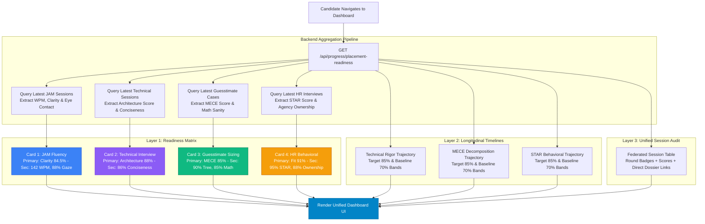

---

## 5. Data Contracts and Database Schema

### Database Schema (SQLAlchemy Models)

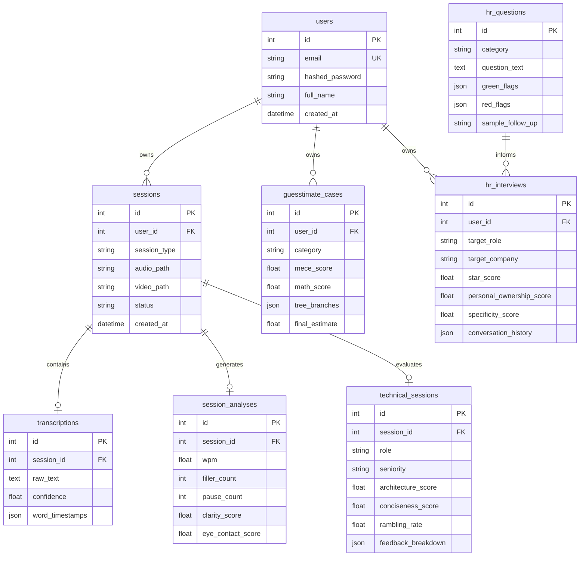

### Placement Readiness Contract (`/api/progress/placement-readiness`)
```json
{
  "total_rounds": 4,
  "attempted_rounds": 4,
  "target_ready_rounds": 4,
  "evaluation_rule": "Round metrics are evaluated on distinct specialized rubrics without artificial single-score blurring.",
  "rounds": [
    {
      "round_id": "jam",
      "name": "JAM Fluency (Just A Minute)",
      "status": "ready",
      "attempts": 3,
      "primary_metric": { "name": "Clarity & Delivery", "value": 84.5, "unit": "/100" },
      "secondary_metrics": [
        { "name": "Speaking Pace", "value": "142.0 WPM" },
        { "name": "Filler Words", "value": "3 detected" },
        { "name": "Eye Contact", "value": "88.0% adherence" }
      ],
      "drill_path": "/record",
      "dossier_path": "/analysis/19"
    },
    {
      "round_id": "technical",
      "name": "Technical Interview",
      "status": "ready",
      "attempts": 5,
      "primary_metric": { "name": "Architecture Rigor", "value": 88.0, "unit": "/100" },
      "secondary_metrics": [
        { "name": "Role Focus", "value": "Senior Backend Architect profile" },
        { "name": "Rambling Rate", "value": "0.0% clean conclusion" }
      ],
      "drill_path": "/technical",
      "dossier_path": "/technical/report/20"
    },
    {
      "round_id": "guesstimate",
      "name": "Guesstimate & Market Sizing",
      "status": "ready",
      "attempts": 2,
      "primary_metric": { "name": "MECE Framework", "value": 85.0, "unit": "/100" },
      "secondary_metrics": [
        { "name": "Decomposition", "value": "90% MECE" },
        { "name": "Math Sanity", "value": "85% accuracy" }
      ],
      "drill_path": "/guesstimate",
      "dossier_path": "/guesstimate/report/21"
    },
    {
      "round_id": "hr",
      "name": "HR & Behavioral Interview",
      "status": "ready",
      "attempts": 4,
      "primary_metric": { "name": "Behavioral Fit", "value": 91.0, "unit": "/100" },
      "secondary_metrics": [
        { "name": "STAR Completeness", "value": "95.0% coverage" },
        { "name": "Personal Agency", "value": "88.0% 'I' ownership" }
      ],
      "drill_path": "/hr",
      "dossier_path": "/hr/report/22"
    }
  ]
}
```

---

### D. Autonomous Curriculum Coach Agent: Closed-Loop LangGraph State Machine

While the 3-Layer Dashboard visualizes multi-round readiness, candidates frequently struggle with **curriculum paralysis**: deciding which round, rubric, or drill difficulty to prioritize on a given day. The **Autonomous Curriculum Coach Agent** solves this by converting static telemetry into a dynamic, closed-loop pedagogical journey.

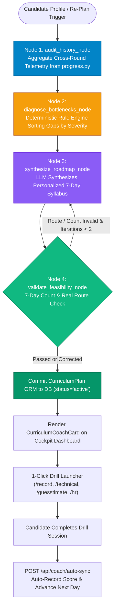

#### 1. Deterministic Multi-Round Telemetry Auditing
The agent directly queries historical performance across all four specialized modules:
* **JAM Fluency:** Evaluates speaking pace deviations (outside 135-155 WPM), filler word density (> 3/session triggers priority flag), and gaze adherence.
* **Technical Architecture:** Scans conciseness score, rambling frequency (> 20% triggers anti-rambling focus), and rote textbook reliance vs. applied systems understanding.
* **Consulting Guesstimate:** Audits the 4 decoupled consulting rubrics: MECE structuring (35%), proxy assumption sanity (25%), mental math flow (20%), and sanity check benchmarks (20%). Identifies order-of-magnitude slips and non-MECE branch partitions.
* **HR & Leadership:** Audits STAR quadrant coverage and personal ownership ("I" vs. "We" agency ratio < 75%).
* **Coverage Baseline:** Explicitly flags unattempted rounds (0 attempts) to ensure balanced campus placement calibration.

#### 2. LangGraph State Machine Topology
Implemented using LangGraph `StateGraph(CurriculumState)`:
1. **`audit_history_node`**: Aggregates verified metrics from database sessions.
2. **`diagnose_bottlenecks_node`**: Evaluates gap metrics against calibrated placement thresholds (85% strong hire, 75% baseline), sorting bottlenecks into `high`, `medium`, and `low` urgency tiers.
3. **`synthesize_roadmap_node`**: LLM generates an adaptive 7-day chronological syllabus with concrete pedagogical rationales for why each drill is prescribed.
4. **`validate_feasibility_node`**: Deterministic guardrail enforcing that all prescribed routes match live platform endpoints (`/record`, `/technical`, `/guesstimate`, `/hr`), and top bottlenecks are addressed in Days 1–2.
5. **Conditional Edge (`route_validation`)**: Automatically re-prompts the synthesizer if validation fails (bounded to 2 iterations), otherwise falls back to a deterministic verified template.

#### 3. Closed-Loop Practice & Auto-Sync Execution
* **ORM Persistence (`curriculum_plans` Table):** Stores `target_role`, `identified_bottlenecks`, `days` array, and completion telemetry.
* **Active Day Spotlight Card:** Highlights the active day's drill with direct 1-click execution (`Launch Prescribed Drill`) pre-routing to the target studio.
* **Auto-Sync Engine (`POST /api/coach/auto-sync`):** Automatically detects newly submitted interview sessions created after plan generation, records candidate scores, marks the day completed, and unlocks the next day.

---

## 6. Guardrails, Calibrations, and Quality Assurance

* **Zero Single-Score Blurring:** Avoids compressing fundamentally distinct abilities (e.g., vocal delivery vs. distributed systems design) into an ungrounded general score.
* **Deterministic Metrics Grounding:** Audio pacing, fillers, and silence are measured directly from waveform/VAD arrays. LLMs are prohibited from inventing delivery stats.
* **Calibrated Benchmark Lines:** Progression timelines display **Target (85%)** and **Baseline (70%)** reference lines representing calibrated preparation benchmarks, explicitly framed as guidance rather than external corporate hiring decisions.
* **Anti-Hallucination Substring Verification:** Every critique, green flag, or red flag must quote an exact substring from the user's transcript.
* **Illustrative Script Clarification:** Rewritten answers or STAR responses are explicitly labeled as *"Illustrative Example"* rather than singular "Ideal Answers".
* **Persistent Disk Logging:** All server execution runs, error logs, and acceptance suite verifications are stored in `backend/logs/` with automatic size-based rotation (`speakflow.log`, `error.log`, `acceptance_suite.log`).

---

## 7. Phased Implementation Plan & Verification Matrix

| Phase | Description | Deliverables | Verification Status |
| :--- | :--- | :--- | :--- |
| **Phase 1** | JAM Fluency & Speech Analysis | WhisperX forced alignment, Silero VAD pause detection, OpenCV gaze tracking, 60s studio, timeline analysis dossier. | **100% Verified** |
| **Phase 2** | Technical Interview Studio | Role-based tracks, conciseness scorer, anti-rambling penalty, jargon detector, sentence-level analysis report. | **100% Verified** |
| **Phase 3** | Guesstimate & Market Sizing | MECE decomposition tree, symbolic math engine, proxy range validator, guesstimate studio and report. | **100% Verified** |
| **Phase 4** | HR & Behavioral Module | 40-question database seed (`hr_questions`), STAR quadrant analyzer, "I" ownership evaluator, adaptive follow-up state machine, studio & dossier. | **100% Verified** |
| **Phase 5** | 3-Layer Placement Dashboard | Layer 1 Readiness Matrix, Layer 2 Longitudinal Trajectories with benchmark thresholds, Layer 3 unified attempt history, persistent logging. | **100% Verified** |
| **Phase 6** | Acceptance Suite Validation | Automated end-to-end multi-round validation test suite running across all 4 rounds and 3 dashboard layers. | **100% Passed (4/4 Rounds)** |
| **Phase 7** | Autonomous Curriculum Coach Agent | LangGraph 4-node cyclic state machine, multi-round historical telemetry audit from `progress.py`, deterministic bottleneck classification, adaptive 7-day personalized interview syllabus, and real-time auto-sync engine. | **100% Verified** |

---

## 8. Architectural Evolution: Post-Mortem & Comprehensive Module Failure Analysis

### A. Failure Analysis of the Initial Approach (Why the Java + Python Dual-Service Model Failed)

The initial architecture proposed a **Java Spring Boot orchestrator** coupled to an external **Python speech service** and a secondary LLM layer. During development, this approach encountered several critical bottlenecks:

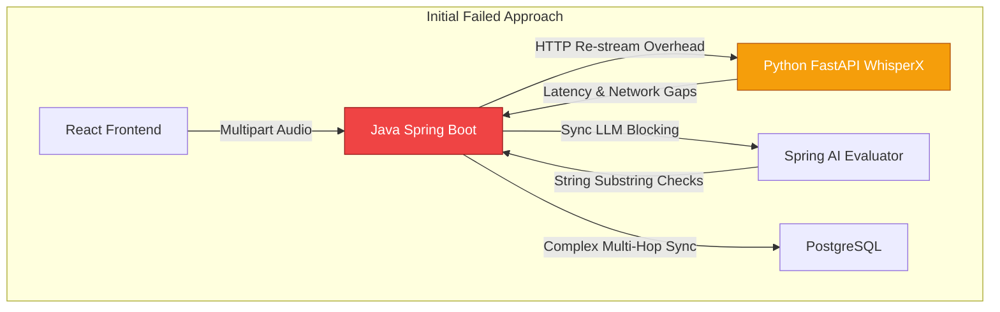

1. **Dual-Service Latency & Network Overhead**: Streaming high-bitrate media from React to Spring Boot, then re-streaming it over internal HTTP to a Python FastAPI service, introduced double serialization, network buffering, and connection timeout risks during 60-second audio bursts.
2. **Double Machine Learning Maintenance Burden**: Splitting ML logic between Python (speech/DSP) and Java (Spring AI) created fragmented dependency environments, making local execution and deployment unnecessarily complex.
3. **Rigid Scripted Interview Flow**: The initial static rubric pipeline (`PRESENT` vs. `MISSING`) couldn't handle real-time conversational state transitions, resume grounding, or adaptive multi-turn pushback.
4. **Lack of Visual & Prosody Grounding**: The original approach evaluated transcripts purely as plain text, missing physical confidence signals (pitch dynamics, uptalk vs. decisive drops, gaze alignment, and nervous gestures).

---

### B. Current Production Architecture (Unified FastAPI + Deterministic ML + Bounded LLM)

The platform was consolidated into a unified, high-performance architecture:

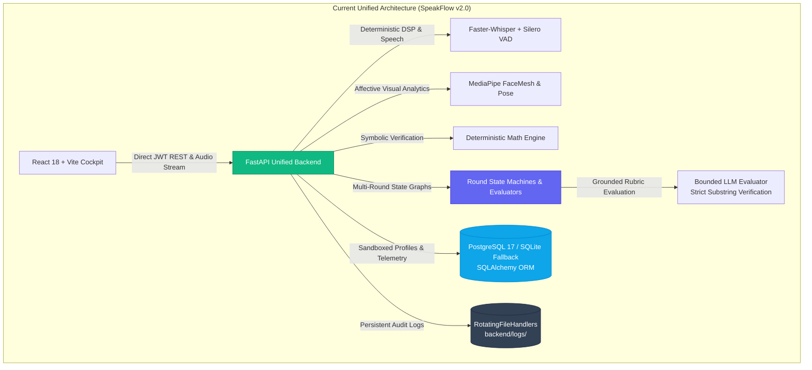

---

### C. Architectural Comparison Matrix

| Architectural Dimension | Initial Approach (Proposed) | Current Production State |
| :--- | :--- | :--- |
| **Backend Layer** | Java Spring Boot (Layer 3) + Python FastAPI (Layer 1) | **Unified Python FastAPI (Async ASGI)** |
| **Speech & Audio DSP** | WhisperX + Silero via HTTP inter-service call | **Native Faster-Whisper + Silero VAD in FastAPI pipeline** |
| **Visual Multimodal** | None (Transcripts only) | **MediaPipe FaceMesh & Posture tracking strictly during speech** |
| **Technical Interview** | Generic rubric presence | **Conciseness (SNR), Anti-Rambling, Jargon vs. Intuition & Sentence Checkpoints** |
| **Guesstimate Round** | Subjective text evaluation | **4-Rubric Consulting Architecture (35/25/20/20 Half-Up) + 5-Tier Branch Audit + Midpoint Range Gauge + 3-Tier Precedence Tornado Sensitivity** |
| **HR Behavioral Round** | Rigid static single follow-up logic | **40-Question Deduplicated DB Bank + STAR Coach + 'I' Ownership Meter** |
| **Dashboard Evaluation** | Single generic radar score | **3-Layer Unified Placement Matrix without score-blurring** |
| **Curriculum Planning** | Static syllabus / no feedback loop | **Autonomous Curriculum Coach (LangGraph 4-node state graph + deterministic bottleneck audit + adaptive 7-day drill roadmap + auto-sync)** |
| **Containerization / DB**| Proposed multi-service setup | **PostgreSQL with automatic resilient SQLite fallback + Rotating File Logs** |

---

### D. End-to-End Interview Execution Sequence

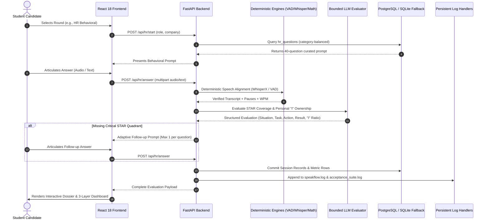