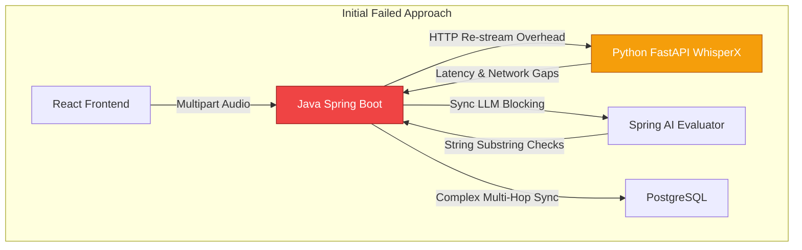

# Unified Implementation Approach: HR Interview & JAM Practice Modules

## 1. Introduction to the Modules

The communication practice platform consists of two distinct but technically synergistic modules: **HR Interview Practice** and **JAM (Just a Minute)**. Both modules share a foundational philosophy: predictable behavior, explainable evidence-based feedback, and strict backend control over LLM behavior.

### HR Interview Practice Module
This module prepares students for campus-placement HR rounds through controlled mock interviews. 
* **Core Function:** It asks predefined HR questions and allows for a limited, adaptive follow-up if an answer is incomplete.
* **Evaluation Focus:** Content quality, situational awareness, and completeness against a predefined rubric (e.g., Situation, Action, Result, Learning).
* **Key Constraint:** The LLM is heavily bounded. It cannot invent rubrics, ask off-script main questions, or ask more than one follow-up per question.

### JAM (Just a Minute) Module
This module helps students practice speaking clearly, concisely, and relevantly for up to 60 seconds on a given topic.
* **Core Function:** Evaluates both the *delivery* of the speech (pauses, pacing, fillers) and the *content* (relevance, structure).
* **Evaluation Focus:** A dual-layer approach measuring objective audio metrics (WPM, filler words, pause duration) and subjective content quality (topic relevance, clarity, conclusion).
* **Key Constraint:** Objective delivery metrics are calculated purely programmatically (via Python/WhisperX/VAD); the LLM is restricted strictly to analyzing the verified text transcript for content structure.

---

## 2. Unified High-Level Architecture

Both modules utilize a shared three-layer pipeline architecture. Instead of deploying autonomous AI agents, the system relies on a strict separation of concerns where Java acts as the absolute source of truth.

**Architecture Flow:**
1. **React Frontend:** User Interface, session management, audio recording, and feedback display.
2. **Java Spring Boot (Layer 3 - Orchestrator):** State management, authentication, validation, LLM coordination, and database persistence.
3. **Python Speech Service (Layer 1 - Objective Metrics):** FastAPI service running WhisperX and Voice Activity Detection (VAD) for transcription, timestamps, and objective speech metrics.
4. **LLM Evaluator via Spring AI (Layer 2 - Content Analysis):** Processes verified transcripts against rubrics to generate structured feedback, evidence, and (for HR) follow-up questions.
5. **PostgreSQL:** Permanent storage for rubrics, questions, session history, and evaluations.

---

## 3. Component Responsibilities

### Layer 1: Python Audio & Metrics Service (Crucial for JAM, Optional for HR)
* Validates and decodes incoming audio.
* Runs **WhisperX** for highly accurate transcription and word-level timestamps.
* Runs **Voice Activity Detection (VAD)** to accurately distinguish pauses from background noise.
* Calculates deterministic metrics (Recording duration, VAD speech duration, WPM, filler word counts, pause counts, longest pause, immediate repetition).
* *Rule:* Never uses LLMs for metric calculations. Preserves transcription uncertainty instead of silently correcting it.

### Layer 2: LLM Evaluator
* **For HR:** Classifies rubric criteria (PRESENT, PARTIAL, MISSING), extracts transcript evidence, and recommends FOLLOW_UP or CONTINUE.
* **For JAM:** Evaluates topic relevance, structure/flow, clarity, and opening/conclusion on a 1-5 scale.
* *Rule:* Must cite specific evidence from the transcript. Cannot invent quotes, assume intent, or evaluate vocal tone/confidence from text.

### Layer 3: Java Spring Boot Backend
* Authenticates users and owns all session state.
* Selects questions/topics and retrieves rubrics from PostgreSQL.
* Coordinates calls to the Python service and Spring AI.
* Enforces hard limits (e.g., 60-second JAM limit, maximum 1 HR follow-up).
* Validates structured model responses (JSON contracts) before saving them.
* Generates the final API response and feedback dashboard data for the frontend.

---

## 4. Implementation Workflows

### A. HR Interview Workflow
1. **Initialization:** Frontend calls `/api/hr/interviews`. Java creates a session, selects a predefined question, and loads its rubric.
2. **Submission:** Student submits text or audio. If audio, Java routes it to Python for transcription.
3. **Interviewer Assessment:** Java sends the rubric, main question, and transcript to the LLM. 
4. **Follow-up Logic:** The LLM returns a structured assessment. If an essential criterion is missing, Java allows *one* follow-up question. If criteria are met, Java proceeds to the next main question.
5. **Completion:** Once all main questions are answered, a post-interview LLM evaluation generates criterion-level results (Strengths, Improvements, Evidence). Java validates and stores the final assessment.

### B. JAM Module Workflow
1. **Initialization:** Student selects a JAM topic and records audio for up to 60 seconds.
2. **Objective Analysis (Python):** Java sends the audio to Python. Python returns a strict JSON payload containing the transcript, WPM, filler count, VAD-detected pauses, and repetitions.
3. **Subjective Analysis (LLM):** Java sends the transcript and topic to the LLM. The LLM returns a JSON payload scoring relevance, structure, and clarity, backed by transcript quotes.
4. **Validation & Consolidation (Java):** Java verifies that the LLM's evidence actually exists in the Python transcript. It consolidates the Python delivery metrics and LLM content scores into a single feedback payload.
5. **Completion:** The UI displays delivery metrics, rubric scores, strengths, and one concrete next practice goal.

---

## 5. Data Contracts and Database Schema

### Cross-Module Database Tables (PostgreSQL)
| Table | Purpose |
| :--- | :--- |
| `practice_sessions` | Common metadata: user ID, module type (HR or JAM), status, timestamps. |
| `hr_questions` / `jam_topics` | Predefined HR questions (and categories) or JAM topics. |
| `rubric_criteria` | Criteria and essentiality flags associated with questions/topics. |
| `responses` | Student answers, generated follow-ups, audio reference keys, response order. |
| `evaluations` | Evaluation metadata, summary, model/prompt versions. |
| `evaluation_results` | Granular criterion status (1-5 score for JAM, PRESENT/MISSING for HR), text evidence, and feedback. |
| `delivery_metrics` | (JAM Specific) Stored JSON blob or columns for WPM, pause counts, filler words, speech duration. |

### JAM Python-to-Java Data Contract
```json
{
  "response_id": "resp_881",
  "transcript": "...",
  "recording_duration_seconds": 60.0,
  "speech_duration_seconds": 48.0,
  "word_count": 105,
  "words_per_minute": 131.25,
  "filler_count": 6,
  "pause_count": 5,
  "longest_pause_seconds": 2.1,
  "transcript_confidence": 0.91
}
```

### LLM-to-Java Evaluation Contract (Example: HR)
```json
{
  "criteria": [
    {
      "criterion": "Personal actions",
      "status": "PRESENT",
      "evidence": "I listened to both teammates and suggested comparing the options.",
      "explanation": "The student describes their own contribution."
    }
  ],
  "decision": "FOLLOW_UP",
  "followUpQuestion": "What did this experience teach you about resolving disagreements?"
}
```
*Note: Java must rigorously validate this schema, ensuring `status` matches allowed enums, `decision` does not violate max follow-up counts, and `evidence` is a genuine substring of the transcript.*

---

## 6. Guardrails and Quality Assurance

* **Strict Boundary Enforcement:** Java dictates session flow. If an LLM recommends a second follow-up for an HR question, Java blocks it. If a student talks for 90 seconds in JAM, Java truncates or flags the submission based on the 60-second rule.
* **No AI Hallucinations in Evidence:** Java conducts a substring validation to ensure any quote the LLM provides in its feedback perfectly matches the Python transcript. If it fails, the evaluation is flagged for retry or human review.
* **Prompt Injection Protection:** Student inputs are strictly treated as data payloads, not executable instructions.
* **Testing Strategy:**
    * **Audio Tests:** Corrupt audio, transcription failures, heavy background noise (testing VAD accuracy).
    * **LLM Contract Tests:** Missing fields, invalid status values, hallucinated quotes.
    * **Behavior Tests:** Short-but-complete answers, rambling off-topic answers (JAM), essential criteria missing (HR).
    * **Human-in-the-Loop:** Compare LLM scores with human-reviewed sample answers before relying on automated scoring.

---

## 8. Architectural Evolution: Post-Mortem & Current State

### A. Failure Analysis of the Initial Approach (Why the Java + Python Dual-Service Model Failed)

The initial architecture (documented in Sections 1–7 above) proposed a **Java Spring Boot orchestrator** coupled to an external **Python speech service** and a secondary LLM layer. During development, this approach encountered several critical bottlenecks:



1. **Dual-Service Latency & Network Overhead**: Streaming high-bitrate media from React to Spring Boot, then re-streaming it over internal HTTP to a Python FastAPI service, introduced double serialization, network buffering, and connection timeout risks during 60-second audio bursts.
2. **Double Machine Learning Maintenance Burden**: Splitting ML logic between Python (speech/DSP) and Java (Spring AI) created fragmented dependency environments, making local execution and deployment unnecessarily complex.
3. **Rigid Scripted Interview Flow**: The initial static rubric pipeline (`PRESENT` vs. `MISSING`) couldn't handle real-time conversational state transitions, resume grounding, or adaptive multi-turn pushback.
4. **Lack of Visual & Prosody Grounding**: The original approach evaluated transcripts purely as plain text, missing physical confidence signals (pitch dynamics, uptalk vs. decisive drops, gaze alignment, and nervous gestures).

---

### B. Current Production Architecture (Unified FastAPI + LangGraph + Dense RAG)

The platform was consolidated into a unified, high-performance architecture:

```mermaid
graph TD
    subgraph Current Unified Architecture (VerbalIQ v2.4)
        Client[React 18 + Vite Cockpit] -->|Direct JWT REST & Audio Stream| API[FastAPI Unified Backend]
        
        API -->|Deterministic DSP & Speech| DSP[PyAV + Librosa + Silero VAD]
        API -->|Affective Visual Analytics| CV[MediaPipe FaceMesh & Pose]
        
        API -->|Semantic Document Embeddings| RAG[(ChromaDB Dense Vectors\nall-MiniLM-L6-v2)]
        API -->|5-Stage State Graph| Agent[LangGraph Conversational Agent]
        
        Agent -->|Adaptive Interview & Articulation Coaching| LLM[NVIDIA Nemotron-3 550B\nLocal Qwen Fallback]
        
        API -->|Sandboxed Profiles & Telemetry| DB[(PostgreSQL 17\nDocker Container)]
    end

    style API fill:#10b981,stroke:#047857,color:#fff
    style Agent fill:#6366f1,stroke:#4338ca,color:#fff
    style DB fill:#0ea5e9,stroke:#0284c7,color:#fff
```

### C. Architectural Comparison Matrix

| Architectural Dimension | Initial Approach (Proposed) | Current Production State |
| :--- | :--- | :--- |
| **Backend Layer** | Java Spring Boot (Layer 3) + Python FastAPI (Layer 1) | **Unified Python FastAPI (Async ASGI)** |
| **Speech & Audio DSP** | WhisperX + Silero via HTTP inter-service call | **Native Faster-Whisper + Silero VAD + Librosa DSP** |
| **Visual Multimodal** | None (Transcripts only) | **MediaPipe FaceMesh & Posture tracking strictly during speech** |
| **Interview Orchestration**| Rigid static single follow-up logic | **LangGraph 5-Stage Adaptive State Machine** |
| **Resume Grounding** | None (Static question library) | **Dense RAG via ChromaDB (`all-MiniLM-L6-v2` dense vectors)** |
| **Evaluation Model** | Generic Spring AI JSON prompt | **Nemotron-3 550B + Token-level JSON Schema logit masking** |
| **Student Communication Focus** | Basic rubric presence | **Conciseness (SNR), Anti-Rambling, Jargon vs. Intuition & STAR Coach** |
| **Containerization** | Proposed multi-service setup | **Docker Compose (PostgreSQL 17 + ChromaDB + Redis)** |

---

### D. Current State Data Flow (Technical Interview Round)

```mermaid
sequenceDiagram
    autonumber
    actor S as Student Candidate
    participant UI as React 18 Frontend
    participant API as FastAPI Backend
    participant RAG as ChromaDB (Dense Vectors)
    participant LG as LangGraph Agent
    participant LLM as NVIDIA Nemotron 550B
    participant DB as PostgreSQL 17

    S->>UI: Uploads Resume (PDF)
    UI->>API: POST /api/technical/resume/upload
    API->>RAG: Chunks & indexes dense embeddings
    S->>UI: Selects Role & Launches Drill
    UI->>API: POST /api/technical/start
    API->>RAG: Fetches top-k semantic resume context
    API->>LG: Initializes 5-Stage Graph State
    LG->>LLM: Synthesizes Stage 1 Challenge
    LLM-->>UI: Verbal / Written Technical Question

    loop 5 Adaptive Communication Stages
        S->>UI: Articulates Answer Spoken or Text
        UI->>API: POST /api/technical/answer
        API->>LG: Evaluates Articulation
        LG->>LLM: Analyzes Conciseness, Anti-Rambling, Jargon & STAR
        LLM-->>LG: Question Score (1-10) + Critique + 45s Model Script
        LG->>DB: Stores Stage Record in PostgreSQL
        LG-->>UI: Next Stage Challenge OR Final Report
    end

    LG->>DB: Commits Overall Score & Mem0 Cross-Session Memory
    UI->>S: Renders Interactive Technical Assessment Dossier
```
