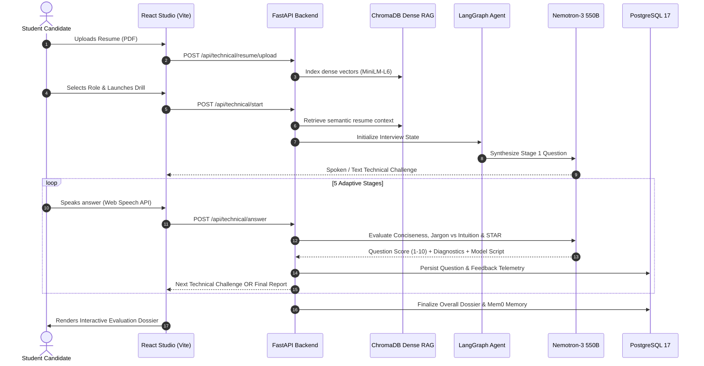

# VerbalIQ (SpeakFlow v2.4) — Multimodal AI Communication & Interview Coach

> **Real-Time Multimodal Speech Analytics, Utterance-Aligned Video Tracking, and Executive Adjudication for High-Stakes Campus Recruitment & Speaking Drills.**

VerbalIQ implements a state-of-the-art **two-stage "extract cues → LLM fuses" architecture** (aligned with recent affective multimodal research: [arXiv:2512.20938v1](https://arxiv.org/html/2512.20938v1) and [arXiv:2308.14320](https://ar5iv.labs.arxiv.org/html/2308.14320)). Rather than feeding heavy raw video frames into vision-language models, VerbalIQ extracts discrete speech intervals via Silero VAD, samples video frames strictly during those utterance windows via MediaPipe, and feeds distilled structured evidence into a local Qwen model via Ollama with token-level JSON Schema constraints.

---

## 🏗️ Architecture O## 🏗️ Architecture Overview

```
                                  [ Candidate Browser (Vite + React) ]
                                                    │
                 ┌──────────────────────────────────┴──────────────────────────────────┐
                 ▼                                                                     ▼
      [ Track 04: JAM Round ]                                              [ Track 01: Technical Round ]
                 │                                                                     │
     Faster-Whisper + Silero VAD                                           ChromaDB RAG Semantic Context
   MediaPipe Vision + Prosody DSP                                        LangGraph 5-Stage Orchestrator
                 │                                                                     │
                 ▼                                                                     ▼
    Local Qwen / Librosa Engine                                              NVIDIA Nemotron-3 550B
  • 100-pt Infraction Penalty Math                                      (via OpenRouter / Ollama fallback)
  • Micro-pauses & Cadence WPM                                                         │
  • Decisive drop vs. Uptalk F0                                                        ▼
                 │                                                   [ Student Articulation Analysis ]
                 │                                                   ├── 1. Conciseness & Anti-Rambling
                 │                                                   ├── 2. Jargon vs Applied Intuition
                 │                                                   ├── 3. STAR Structure Breakdown
                 │                                                   └── 4. Model 45s Concise Script
                 │                                                                     │
                 └──────────────────────────────────┬──────────────────────────────────┘
                                                    │
                                                    ▼
                                  [ PostgreSQL 17 + Docker Services ]
                                  ├── User Auth & Sandboxed Profiles
                                  ├── Universal Sessions & Detailed Reports
                                  └── Cross-Session Mem0 Memory Engine
```

---

## ⚡ Core Practice Modules

### 1. Track 01: Conversational Technical Round (Student-Focused)
Designed specifically for campus placement preparation and student engineering interviews:
- **LangGraph State Orchestrator**: Dynamically cycles through 5 communication stages (Architectural Overview, Conceptual Simplification, Technical Disagreement, Outage Incident Communication, and Strategic Trade-offs).
- **Dense RAG Resume Ingestion**: Chunks candidate PDF resumes and indexes 384-dimensional dense vectors in ChromaDB (`sentence-transformers/all-MiniLM-L6-v2`) to interrogate actual candidate projects.
- **Student Communication Evaluation (Nemotron 550B)**:
  - **Technical Conciseness & Anti-Rambling Metric**: Identifies circular monologues (4+ minutes) and empty padding; scores Signal-to-Noise Ratio (1-10) and pinpoints where the candidate should have concluded.
  - **Jargon vs. Applied Understanding**: Differentiates memorized textbook definitions (e.g. GeeksforGeeks/Wikipedia verbatim) from practical applied intuition and real-world analogies.
  - **STAR Structure Coach**: Automatically tracks whether project responses cover **S**ituation, **T**ask, **A**ction (specific personal implementation), and **R**esult (measurable impact).
  - **Model 45-Second Concise Script**: Generates an exemplary concise answer script demonstrating how a top candidate would articulate the response without fluff.
- **Stateful Resumption & Persistence**: Active technical sessions are preserved across tab switches and browser refreshes with one-click **Resume Drill ↗** support in Session History.



---

### 2. Track 04: JAM (Just-A-Minute) Round
- **Deterministic Infraction Scoring**: Starts from **100.0 baseline points** and applies exact rule-based penalties:
  - Fillers & Hesitations (`um`, `uh`, `you know`): $4.0\text{ pts}$ deduction (max $35\text{ pts}$).
  - Pauses & Silence (via Librosa & VAD): $(\text{silence} - 3.0\text{s}) \times 2.5\text{ pts}$ + $8\text{ pts}$ if single freeze $\ge 2.0\text{s}$.
  - Repetitions: $5.0\text{ pts}$ per repeated content word ($\ge 3$ occurrences).
  - Duration Adherence: Penalties if $< 45\text{s}$ or $> 68\text{s}$ against the 60-second target.
  - Cadence Pace: $5.0\text{ pts}$ if $< 100\text{ WPM}$ or $> 185\text{ WPM}$.
- **Acoustic Prosody DSP**: Fundamental pitch frequency ($F_0$) dynamic range, RMS energy projection in dB, and decisive drops vs. hesitant uptalk.
- **Utterance-Aligned Computer Vision**: MediaPipe FaceMesh & Pose tracking eye contact ratio, screen-offset cone tolerance, and head stability strictly during spoken intervals.

---

### 3. Authentication & PostgreSQL Sandbox
- **Encrypted JWT Authentication**: Clean login and signup flow stored in PostgreSQL.
- **Landing Gatekeeper**: Automatic route protection routing unauthenticated visitors to `/login` before accessing the studio.
- **Sandbox Isolation**: Resumes, progress trends, and interview histories are strictly sandboxed per authenticated user.

---

## 🐳 Docker Services Setup

SpeakFlow relies on three core containerized services defined in `docker-compose.services.yml`:
- **PostgreSQL 17** (`port 5432`): Relational data store for users, sessions, transcriptions, and technical evaluations.
- **ChromaDB** (`port 8100`): Vector database for dense semantic resume RAG.
- **Redis** (`port 6379`): Cache and background task broker.

### Start Services
```powershell
docker compose -f docker-compose.services.yml up -d
```

### Stop Services
```powershell
docker compose -f docker-compose.services.yml down
```

---

## 🚀 Local Development Setup

### 1. Backend (FastAPI + Python 3.12)
```powershell
cd backend
# Activate your virtual environment
& "..\.venv\Scripts\activate"

# Start the API server
uvicorn main:app --reload --port 8000
```
API Documentation will be live at `http://127.0.0.1:8000/docs`.

### 2. Frontend (React + TypeScript + Vite)
```powershell
cd frontend
npm install
npm run dev
```
Open `http://localhost:5173` in your browser.

---

## 📡 Key API Endpoints Summary

| Method | Endpoint | Description |
| :--- | :--- | :--- |
| `POST` | `/api/auth/register` | Register new user in PostgreSQL |
| `POST` | `/api/auth/login` | Login and receive bearer JWT |
| `GET` | `/api/technical/resume/status` | Check authenticated candidate's active indexed resume |
| `POST` | `/api/technical/resume/upload` | Ingest PDF resume into ChromaDB dense vectors |
| `POST` | `/api/technical/start` | Launch LangGraph technical interview round |
| `POST` | `/api/technical/answer` | Evaluate response for Conciseness, Jargon vs Intuition & STAR |
| `GET` | `/api/technical/report/{id}` | Complete technical dossier with model scripts |
| `POST` | `/api/sessions` | Multipart video/audio upload for JAM round |
| `POST` | `/api/sessions/{id}/analyze` | Triggers Whisper + MediaPipe + Librosa DSP pipeline |
| `GET` | `/api/progress/summary` | Global progress, practice streak, and competency radar |

---

## 📄 License
MIT. Built for Campus Recruitment & Placement Communication Preparation.
