# SpeakFlow: Functional Specification & Domain Architecture

> **Comprehensive Functional Document: Problem Space, Domain Context, Interventions, User Journey, and Agentic Construct.**  
> *Target Branch: `main` | Module: Core System Specification*

---

## 1. Understanding of the Problem

### A. The Core Challenge: Conversational Collapse Under Pressure
In competitive campus recruitment (engineering, data systems, management consulting, and investment banking), student candidates face a severe structural hurdle: **the chasm between theoretical competency and live conversational articulation under evaluation pressure**.

While candidates spend months solving coding challenges on algorithmic platforms or studying system design textbooks, they routinely fail in actual interview rooms due to **conversational collapse**:
1. **Pacing Disintegration & Freezes**: Under impromptu speaking pressure (e.g., Just A Minute rounds), candidates either accelerate to an incomprehensible rush ($>175$ WPM) or experience prolonged cognitive freezes ($>2$ seconds), masked by high-frequency audible filler sounds (*"um"*, *"uh"*, *"basically"*, *"like"*).
2. **The "Rambling" Vulnerability in Technical Rounds**: When probed on complex systems architecture (e.g., caching strategies, distributed consensus, ACID vs. BASE), uncertain candidates answer the core question in 30 seconds but then talk in circular loops for two minutes, hoping keyword repetition will compensate for depth.
3. **Arithmetic slips & MECE Violations in Consulting Rounds**: Under mental arithmetic stress, candidates commit order-of-magnitude slips, double-count market demographics, or omit fundamental consumer segments without Mutually Exclusive, Collectively Exhaustive (MECE) discipline.
4. **The "We" Dispersion Trap in Behavioral Rounds**: Candidates habitually frame personal achievements in passive, collective pronouns (*"We built...", "Our team resolved..."*), concealing their specific individual agency, decision ownership, and quantifiable business outcomes.

### B. Why Generic Conversational AI Fails
Standard conversational chatbots and generic LLM wrappers fail to address this problem due to five foundational architectural defects:
* **The Single-Score Fallacy**: Generic tools collapse diverse competencies into an arbitrary composite percentage (e.g., *"Overall Score: 78%"*), obscuring whether a candidate has delivery defects, architectural rambling, arithmetic slips, or behavioral ambiguity.
* **LLM Arithmetic Hallucination**: Large language models cannot reliably perform multi-step mental arithmetic. When asked to evaluate market sizing estimations, LLMs hallucinate calculations, validate impossible orders of magnitude, or penalize correct candidate math.
* **Acoustic & Prosodic Blindspots**: Evaluating plain text transcripts ignores physical confidence signals: voice tremors, anxious pitch spikes, robotic monotone delivery, vocal fry, breathy strain, and declarative uptalk (turning assertions into questions).
* **Delayed Post-Hoc Feedback Disconnect**: Traditional platforms require candidates to record an entire answer into a blank screen, submit a video file, and wait 15–30 seconds for feedback. By the time advice appears, the candidate has forgotten their internal cognitive and physiological state at the moment the mistake occurred.
* **Hallucinated & Unanchored Critiques**: Generic AI evaluators generate vague qualitative generalities (*"Be more confident"*, *"Structure your answer better"*) without citing exact verbatim transcript evidence.

---

## 2. Domain-Level Contextualisation of the Current Process and Its Challenges

### A. The Campus Recruitment Pipeline
Top-tier institutional recruitment follows a rigorous, multi-stage evaluation pipeline designed to progressively filter thousands of applicants down to single-digit acceptance rates:

```
┌─────────────────┐      ┌─────────────────────────┐      ┌──────────────────────────┐      ┌──────────────────────────┐
│  Hurdle 1: JAM  │ ───> │   Hurdle 2: Technical   │ ───> │  Hurdle 3: Guesstimate   │ ───> │   Hurdle 4: Behavioral   │
│ Fluency & Spont.│      │ Architecture & Tradeoffs│      │  MECE Tree & Mental Math │      │   STAR & 'I' Ownership   │
└─────────────────┘      └─────────────────────────┘      └──────────────────────────┘      └──────────────────────────┘
```

1. **Hurdle 1 — JAM (Just A Minute) / Extempore Round**:
   - *Role*: Initial communication filter to eliminate candidates unable to formulate and structure spontaneous thought in English under a strict 60-second limit.
   - *Evaluator Focus*: Natural vocal cadence ($130–160$ WPM), pause structure ($<1.2$s), minimal filler words ($<3$/min), direct eye contact ($>80\%$), and clear beginning-middle-end cohesion.
2. **Hurdle 2 — Technical Architecture Round**:
   - *Role*: Eliminates "code monkeys" who write syntax but cannot articulate distributed system trade-offs to engineering leads or cross-functional stakeholders.
   - *Evaluator Focus*: Signal-to-Noise Ratio (SNR), identifying the exact conclusion checkpoint, explaining concrete trade-offs (e.g., latency vs. consistency, write-heavy vs. read-heavy caching), and de-biasing textbook jargon.
3. **Hurdle 3 — Guesstimate & Market Sizing Round**:
   - *Role*: Core evaluation for consulting, product management, and strategic analyst tracks.
   - *Evaluator Focus*: Top-down or bottom-up tree decomposition, Mutually Exclusive, Collectively Exhaustive (MECE) boundary clarity, defensible proxy selection (household size, vehicle lifespan), out-loud mental arithmetic, and macro sanity checking against real-world bounds.
4. **Hurdle 4 — HR & Behavioral Interview**:
   - *Role*: Cultural fit and leadership potential assessment by HR business partners and senior directors.
   - *Evaluator Focus*: Complete STAR execution (Situation, Task, Action, Result), unambiguous first-person accountability (*"I decided"*, *"My role was"*), and measurable business impact ($35\%$ latency reduction, $\$150\text{k}$ cloud savings).

### B. Systemic Challenges in Current Preparation Ecosystems
* **Placement Cell Resource Bottlenecks**: University placement departments typically have 2–5 training officers managing cohorts of 1,000–5,000 graduating seniors. Conducting 1:1 individualized mock interviews across all 4 specialized rounds is physically impossible.
* **Peer-to-Peer Feedback Incoherence**: Students resort to practicing with peers who lack calibrated evaluation standards, resulting in the "blind leading the blind" where bad communication habits are reinforced rather than corrected.
* **Subjective Human Evaluator Variance**: Human interviewers grade on uncalibrated subconscious biases: evaluating regional accents as poor grammar, confusing fast speech with high intelligence, or forgiving severe technical rambling if the candidate appears charismatic.

---

## 3. Proposed Interventions

SpeakFlow introduces six architectural interventions that directly resolve the structural flaws of traditional interview preparation:

```
                               SpeakFlow Core Interventions
                                             │
      ┌──────────────────┬───────────────────┼───────────────────┬──────────────────┐
      ▼                  ▼                   ▼                   ▼                  ▼
1. Deterministic   2. Decoupled        3. Real-Time        4. Multi-Modal     5. 3-Layer
   Precedence         Specialization      In-Flight           Affective          Placement
   (Math & DSP)       (Zero Blurring)     Cadence (Laya)      Grounding          Readiness
```

### Intervention 1: Deterministic Precedence (Mathematical & Acoustic Sovereignty)
* **Principle**: *Deterministic code must compute and verify all objective telemetry before any LLM evaluates qualitative text.*
* **Implementation**:
  - Exact Word-Per-Minute curves, pause counts, freeze durations, and filler frequencies are calculated deterministically via WhisperX phoneme alignment and Silero VAD energy gating.
  - Step-by-step arithmetic calculations, rounding, and range variance in Guesstimates are executed by Python symbolic math code. No LLM is permitted to perform arithmetic.
  - Personal agency ("I" vs. "We" ownership ratio) is computed via deterministic regex token analysis over verified transcripts.

### Intervention 2: Four Decoupled Specialized Studios (Zero Score Blurring)
* **Principle**: *Never average dissimilar communication competencies into a single composite score.*
* **Implementation**: Each round maintains a specialized evaluation rubric:
  - **JAM**: Rolling Pacing Zones + Silence Duration + MediaPipe Eye Contact Adherence.
  - **Technical**: Signal-to-Noise Ratio (SNR) + Sentence-Level Conclusion Checkpoint Locator.
  - **Guesstimate**: Four Consulting Rubrics (MECE Structuring 35%, Proxy Sanity 25%, Mental Math 20%, Reality Validation 20% with conventional half-up rounding) + 5-Tier Branch Evidence Audit.
  - **HR**: STAR Quadrant Coverage + First-Person Agency Ratio + Quantifiable Business Impact.

### Intervention 3: Real-Time In-Flight Cadence Coaching (Laya Engine)
* **Principle**: *Prevent conversational meltdown while speech is occurring rather than lamenting it after the turn is over.*
* **Implementation**:
  - LiveKit WebRTC interactive room architecture delivers two-way low-latency ($<100$ms) video/audio communication.
  - Full-duplex WebSocket streams (`/ws/emotion`, `/ws/laya`) ingest 16kHz linear PCM audio slices in 250ms windows into an in-memory Redis ring buffer.
  - The **Laya Cadence Coach** evaluates rolling 3-second WPM windows, driving an interactive cockpit **Pacing HUD**:
    - *Optimal Pace*: $130–160$ WPM (Green indicator).
    - *Rushing Warning*: $>165$ WPM (Amber indicator).
    - *Hesitant Warning*: $<120$ WPM (Blue indicator).
    - *Dead-Air Alert*: Visual freeze alarm if silence exceeds $1.5$s during an active turn.
  - **Socratic In-Flight Micro-Nudges**: If a candidate stalls, diverges, or omits critical actions, Laya emits subtle, non-intrusive on-screen guidance banners ($<12$ words, e.g., *"Focus on your individual action"*, *"Quantify the outcome"*) without audio interruption.

### Intervention 4: Multi-Modal Affective & Prosodic Grounding
* **Principle**: *Ground candidate confidence in physical acoustic soundwaves and visual presence.*
* **Implementation**:
  - **Audeering Wav2Vec2 MSP-Dim (`wav2vec2-large-robust-12-ft-emotion-msp-dim`)**: Continuous real-time regression of Arousal (calm vs. anxious), Valence (negative vs. positive), and Dominance (assertive vs. submissive), projected onto the **Live Confidence Needle**.
  - **Praat-Parselmouth Clinical Acoustic DSP**: Extracts fundamental frequency (F0 pitch mean/SD), vocal jitter (micro-tremor/anxiety), shimmer (vocal breathiness/strain), harmonics-to-noise ratio (HNR resonance), and declarative uptalk inflections.
  - **MediaPipe FaceMesh & Posture**: Calculates gaze vector alignment within a $\pm 15^\circ$ cone and head/posture stability strictly during active vocal speech.

### Intervention 5: 3-Layer Placement Readiness Framework
* **Principle**: *Deliver transparent, longitudinal placement preparation analytics.*
* **Implementation**:
  - **Layer 1 (Readiness Matrix)**: 4 independent diagnostic cards displaying primary and secondary round metrics.
  - **Layer 2 (Longitudinal Trajectories)**: Historical trendlines tracking student progress against calibrated institutional thresholds (Baseline 70% / Placement Target 85%).
  - **Layer 3 (Cross-Round Session Audit)**: Chronological session log providing direct links to comprehensive dossiers (`/analysis/:id`, `/technical/report/:id`, `/guesstimate/report/:id`, `/hr/report/:id`).

### Intervention 6: Autonomous Closed-Loop Curriculum Planning
* **Principle**: *Eliminate candidate curriculum paralysis through dynamic bottleneck analysis.*
* **Implementation**: A 4-node LangGraph autonomous agent audits multi-round attempt history, identifies active performance bottlenecks (e.g., severe technical rambling or low behavioral ownership), and generates an adaptive 7-day drill roadmap.

---

## 4. The High-Level User Journey

### A. End-to-End User Journey Workflow

```mermaid
flowchart TD
    subgraph Stage1 ["Stage 1: Calibration & Discovery"]
        Entry(["Candidate Lands on SpeakFlow Cockpit"]) --> ViewMatrix["Review 3-Layer Placement Readiness Matrix<br/>Inspect JAM, Tech, Guesstimate, and HR Status"]
        ViewMatrix --> CoachPrompt["Autonomous Curriculum Coach Recommends Priority Drill<br/>e.g., 'Target HR Behavioral: Personal Ownership is at 62%'"]
    end

    subgraph Stage2 ["Stage 2: Studio Preparation & Environment Gate"]
        CoachPrompt --> SelectStudio["Launch Target Studio<br/>(JAM Fluency | Tech Architecture | Guesstimate | HR Behavioral)"]
        SelectStudio --> EnvCheck{"Hardware & Acoustic Check"}
        EnvCheck -->|Signal < -35 dBFS| AlertMic["Refuse Launch: Check Mic / Ambient Noise"]
        EnvCheck -->|Valid Signal| EstablishSession["Establish Session Handshake<br/>LiveKit WebRTC + WebSocket Telemetry Stream"]
    end

    subgraph Stage3 ["Stage 3: Live Interview Turn & In-Flight Guidance"]
        EstablishSession --> PresentPrompt["Interviewer Delivers Tailored Prompt<br/>(e.g., Engineering System Architecture Scenario)"]
        PresentPrompt --> CandidateSpeaks["Candidate Articulates Spoken Response"]
        
        par WebRTC Media Streaming
            CandidateSpeaks -->|Raw AV Tracks| LiveKitRoom["LiveKit Ultra-Low Latency AV Room"]
        and Full-Duplex Telemetry
            CandidateSpeaks -->|250ms PCM Slices| WSTelemetry["WebSocket Telemetry Gateway"]
            WSTelemetry --> RedisRing["Redis Sliding Audio Ring Buffer"]
            RedisRing --> DSPPipeline["Streaming DSP: Audeering Emotion + Praat Prosody + Rolling WPM"]
            DSPPipeline --> LayaHUD["Update Cockpit Pacing HUD & Live Confidence Needle"]
            LayaHUD --> InFlightNudge{"Cadence Collapse or Gap?"}
            InFlightNudge -->|Yes| PushNudge["Render Non-Intrusive Socratic Micro-Nudge"]
            PushNudge --> CandidateSpeaks
            InFlightNudge -->|No| CandidateSpeaks
        end
    end

    subgraph Stage4 ["Stage 4: Turn Completion & Human Approval Gate"]
        CandidateSpeaks --> TurnComplete["Candidate Concludes Turn / Silence Detected"]
        TurnComplete --> CandidateChoice{"Candidate Approval"}
        CandidateChoice -->|Retake Drill| EstablishSession
        CandidateChoice -->|Approve & Finalize| TriggerEval["Trigger Deterministic & LLM Evaluation"]
    end

    subgraph Stage5 ["Stage 5: Synthesis, Evidence Grounding & Dossier"]
        TriggerEval --> WhisperAlign["Faster-Whisper / WhisperX Forced Alignment<br/>Generate Verified Word Timestamps"]
        WhisperAlign --> SpecializedEvaluator["Specialized Round Evaluation:<br/>• Technical: Sentence Checkpoint & Rambling Detection<br/>• Guesstimate: Symbolic Math Sanity & MECE Audit<br/>• HR: STAR Quadrant Classification & 'I' Agency Ratio"]
        SpecializedEvaluator --> GroundingGate{"Verbatim Substring Validation"}
        GroundingGate -->|Exact Substring Matches| CommitDB["Commit Metrics to PostgreSQL / SQLite Fallback"]
        GroundingGate -->|Hallucination Detected| DiscardCritique["Discard Unsupported Feedback Item"]
        DiscardCritique --> CommitDB
        CommitDB --> GenerateDossier["Render Interactive Round Dossier<br/>Waveform + Sentence Checkpoints + 45s Model Rewrite"]
    end

    subgraph Stage6 ["Stage 6: Longitudinal Progress & Readiness Certification"]
        GenerateDossier --> UpdateDashboard["Update 3-Layer Placement Dashboard<br/>Recalculate Trajectories & Placement Target 85% Progress"]
        UpdateDashboard --> CertifiedReady{"All 4 Rounds >= 85%?"}
        CertifiedReady -->|Yes| PlacementBadge["Award Placement Ready Certification Dossier"]
        CertifiedReady -->|No| NextDrill["Re-Plan Next Curriculum Roadmap Step"]
    end

    style Entry fill:#1e293b,stroke:#475569,color:#fff
    style SelectStudio fill:#0284c7,stroke:#0369a1,color:#fff
    style CandidateSpeaks fill:#f59e0b,stroke:#b45309,color:#fff
    style LayaHUD fill:#f43f5e,stroke:#be123c,color:#fff
    style CandidateChoice fill:#b45309,stroke:#78350f,color:#fff
    style SpecializedEvaluator fill:#6d28d9,stroke:#4c1d95,color:#fff
    style CommitDB fill:#047857,stroke:#065f46,color:#fff
    style GenerateDossier fill:#0284c7,stroke:#0369a1,color:#fff
    style PlacementBadge fill:#10b981,stroke:#047857,color:#fff
```

### B. Detailed User Journey Walkthrough
1. **Diagnostic Onboarding**: Candidate logs in and views their **Placement Readiness Matrix**. Visual status badges indicate readiness across the four interview rounds without cross-round score blurring.
2. **Pedagogical Recommendation**: The **Autonomous Curriculum Coach** analyzes recent session history and highlights current bottlenecks (e.g., *"Technical Architecture is ready at 88%, but HR Behavioral ownership is lagging at 62%"*).
3. **Studio Environment Gate**: Candidate enters the recommended studio. System verifies audio energy levels (guarding against muted microphones or excessive background noise).
4. **Live Turn Articulation & In-Flight Guidance**:
   - The candidate speaks naturally to the virtual interviewer avatar.
   - The cockpit's **Pacing HUD** displays live rolling WPM, providing immediate visual feedback to maintain optimal tempo ($130–160$ WPM).
   - If an extended freeze ($>1.5$s) or structural gap occurs, Laya displays a subtle, silent Socratic micro-nudge.
5. **Turn Finalization & Human Approval**: Candidate decides whether to approve the turn for scoring or execute a retake.
6. **Multi-Modal Dossier Generation**: System synthesizes the comprehensive evaluation payload: verbatim substring quotes, acoustic prosody profiles, sentence rambling checkpoints, and optimized model rewrites.
7. **Readiness Trajectory Tracking**: Scores update the candidate's longitudinal trendlines, tracking their progression toward the institutional 85% Placement Readiness Target.

---

## 5. The Tech and Agentic Construct

### A. Agentic Architecture: Deterministic State Machine vs. Unconstrained ReAct
SpeakFlow explicitly rejects unconstrained, fully autonomous ReAct (Reasoning + Acting) loops in favor of a **Deterministic State Machine with Bounded Specialized Probes**:

| Architectural Dimension | Unconstrained Autonomous ReAct (Rejected) | Deterministic State Machine (SpeakFlow) |
| :--- | :--- | :--- |
| **Execution Predictability** | Non-deterministic; prone to infinite reasoning loops and tangential questioning. | Strict, predictable state transitions governed by explicit round rules. |
| **Latency Profile** | Variable and high ($3–8$ seconds per turn); unacceptable for real-time interview flow. | Predictable, low-latency execution ($<250$ms streaming telemetry, $<2$s turn evaluation). |
| **Adaptive Follow-Up Control** | Uncontrolled probing; may ask 5 follow-ups on minor details while missing core competencies. | Strictly bounded state machine allowing at most 1 targeted follow-up if an essential quadrant is absent. |
| **Hallucination Surface** | High; LLM generates both evaluation metrics and interview transitions. | Zero hallucination on metrics; code governs math, acoustics, and states; LLM is restricted to bounded JSON extraction. |

### B. High-Level Technical Architecture Diagram

```mermaid
graph TB
    subgraph ClientCockpit ["Frontend Cockpit Layer (React 18 + Vite + Tailwind)"]
        UI_HOME["Student Cockpit UI"]
        UI_DASH["3-Layer Readiness Dashboard"]
        UI_JAM["JAM Studio (60s Timer)"]
        UI_TECH["Technical Studio (Architecture Drills)"]
        UI_GUEST["Guesstimate Studio (MECE Trees)"]
        UI_HR["HR Studio (LiveKit Video AV)"]
        UI_HUD["Laya Cadence HUD & Confidence Needle"]
        UI_DOSSIER["Interactive Evaluation Dossiers"]
    end

    subgraph MediaAndStreaming ["Media & Real-Time Streaming Layer"]
        LK_SERVER["LiveKit WebRTC Media Server<br/>Low-Latency Bidirectional AV Track Routing"]
        WS_GATEWAY["WebSocket Gateway (FastAPI)<br/>/ws/emotion/:id & /ws/laya/:id"]
        REDIS_STREAM[("Redis Audio Ring Buffer<br/>Sliding 16kHz Linear PCM Window")]
    end

    subgraph APIGateway ["API Controller & Gateway Layer (FastAPI ASGI)"]
        ROUTER_AUTH["/api/auth (JWT Security & User Profiles)"]
        ROUTER_JAM["/api/analysis (JAM Audio/Vision Ingestion)"]
        ROUTER_TECH["/api/technical (Architecture Evaluation & Rewrites)"]
        ROUTER_GUEST["/api/guesstimate (MECE & Math Engine Routing)"]
        ROUTER_HR["/api/hr (STAR Evaluator & Question Dispatcher)"]
        ROUTER_LIVEKIT["/api/hr/livekit-token (WebRTC Token Engine)"]
        ROUTER_PROG["/api/progress (3-Layer Matrix & Trajectories)"]
    end

    subgraph Layer1Telemetry ["Layer 1: Deterministic DSP & Measurement Engines"]
        ENG_WHISPER["Faster-Whisper / WhisperX<br/>Word-Level Forced Alignment"]
        ENG_VAD["Silero Voice Activity Detection<br/>Pause Boundaries & Silence Extraction"]
        ENG_CV["OpenCV / MediaPipe FaceMesh<br/>Gaze Vector Cone & Posture Stability"]
        ENG_MATH["Symbolic Math Sanity Engine<br/>Deterministic Arithmetic & Scaling"]
        ENG_PRAAT["Praat-Parselmouth DSP Engine<br/>F0 Pitch, Jitter, Shimmer, HNR & Uptalk"]
    end

    subgraph Layer2Reasoning ["Layer 2: Affective ML & Bounded LLM Reasoning Engines"]
        ML_AUDEERING["Audeering Wav2Vec2 MSP-Dim<br/>Continuous Arousal, Valence, Dominance"]
        AGENT_LAYA["Laya Cadence Coach & Socratic Nudge Engine<br/>Rolling WPM, Freeze Alarms & Micro-Prompts"]
        LLM_STAR["STAR Quadrant Classifier & Agency Scorer<br/>(Pydantic Schema Bounded)"]
        LLM_RAMBLE["Anti-Rambling & Sentence Checkpoint Engine"]
        LLM_MECE["MECE Decomposition & Proxy Sanity Auditor"]
        COACH_GRAPH["Autonomous Curriculum Coach<br/>(LangGraph 4-Node Closed-Loop State Machine)"]
    end

    subgraph Layer3Persistence ["Layer 3: Persistence, Failover & Audit Layer"]
        DB_PRIMARY[("PostgreSQL 17 Primary Database<br/>SQLAlchemy ORM")]
        DB_FALLBACK[("Resilient SQLite Dynamic Fallback<br/>(speakflow.db)")]
        ROTATING_LOGS[("Rotating File Handlers<br/>speakflow.log / acceptance_suite.log")]
    end

    %% Client Interactions
    UI_HOME --> ROUTER_AUTH
    UI_DASH --> ROUTER_PROG
    UI_DOSSIER --> ROUTER_PROG
    UI_JAM --> ROUTER_JAM
    UI_TECH --> ROUTER_TECH
    UI_GUEST --> ROUTER_GUEST
    UI_HR --> ROUTER_HR
    UI_HR --> ROUTER_LIVEKIT

    %% LiveKit WebRTC and WebSocket Flows
    UI_HR <-->|Sub-100ms AV Media Tracks| LK_SERVER
    UI_HR <-->|Full-Duplex 250ms Audio Slices| WS_GATEWAY
    WS_GATEWAY -->|Buffer Slices| REDIS_STREAM
    REDIS_STREAM -->|Windowed Ingestion| ML_AUDEERING
    REDIS_STREAM -->|Acoustic Ingestion| ENG_PRAAT
    REDIS_STREAM -->|Energy Ingestion| ENG_VAD

    %% Real-time feedback
    ML_AUDEERING --> AGENT_LAYA
    ENG_PRAAT --> AGENT_LAYA
    ENG_VAD --> AGENT_LAYA
    AGENT_LAYA -->|Real-Time Pacing Cues & Nudges| WS_GATEWAY
    WS_GATEWAY -->|Live Broadcast| UI_HUD

    %% Turn-completion processing
    ROUTER_JAM --> ENG_WHISPER
    ROUTER_JAM --> ENG_VAD
    ROUTER_JAM --> ENG_CV

    ROUTER_TECH --> LLM_RAMBLE
    ROUTER_GUEST --> ENG_MATH
    ROUTER_GUEST --> LLM_MECE
    ROUTER_HR --> LLM_STAR

    ROUTER_PROG --> COACH_GRAPH

    %% Persistence & Failover
    APIGateway --> DB_PRIMARY
    DB_PRIMARY -.->|3s Timeout Automatic Fallback| DB_FALLBACK
    APIGateway --> ROTATING_LOGS
    AGENT_LAYA --> DB_PRIMARY

    style ClientCockpit fill:#1e293b,stroke:#475569,color:#fff
    style LK_SERVER fill:#0284c7,stroke:#0369a1,color:#fff
    style WS_GATEWAY fill:#2563eb,stroke:#1d4ed8,color:#fff
    style REDIS_STREAM fill:#dc2626,stroke:#991b1b,color:#fff
    style Layer1Telemetry fill:#047857,stroke:#065f46,color:#fff
    style Layer2Reasoning fill:#6d28d9,stroke:#4c1d95,color:#fff
    style AGENT_LAYA fill:#f43f5e,stroke:#be123c,color:#fff
    style Layer3Persistence fill:#4338ca,stroke:#3730a3,color:#fff
```



### C. Detailed Component Specifications

#### 1. Real-Time Streaming & Media Subsystem
* **LiveKit WebRTC Media Server**: Coordinates ultra-low-latency bidirectional media rooms between candidate webcam/microphone and virtual interviewer tracks. Eliminates file upload dropouts and client-side encoding latency.
* **WebSocket Gateway (`/ws/emotion`, `/ws/laya`)**: Full-duplex WebSocket controller handling binary audio frame streaming and JSON telemetry dispatch with sub-250ms latency.
* **Redis Audio Ring Buffer**: Sliding-window 16kHz mono linear PCM in-memory cache, decoupling high-frequency client audio arrival from parallel DSP feature extraction loops.

#### 2. Deterministic Telemetry Subsystem (Layer 1)
* **Faster-Whisper / WhisperX**: Executes local word-level forced alignment, mapping each spoken phoneme and word to millisecond start and end timestamps.
* **Silero VAD**: Acoustic energy classifier extracting pause boundaries ($>1.2$s) independently of ambient acoustic noise.
* **MediaPipe FaceMesh**: Computes gaze vectors within a $\pm 15^\circ$ central cone and monitors head roll/pitch/yaw strictly during active speech segments.
* **Praat-Parselmouth DSP**: Computes clinical vocal metrics: Fundamental Frequency (F0), local jitter %, local shimmer %, Harmonics-to-Noise Ratio (dB), and declarative terminal uptalk.
* **Symbolic Math Engine**: Python symbolic arithmetic engine evaluating step-by-step candidate calculation trees with conventional half-up rounding ($\lfloor \text{Score} + 0.5 \rfloor$).

#### 3. Affective ML & Bounded Reasoning Subsystem (Layer 2)
* **Audeering Wav2Vec2 MSP-Dim**: Continuous acoustic regression model mapping speech soundwaves to continuous dimensional coordinates (Arousal, Valence, Dominance).
* **Laya Cadence Coach & Socratic Nudge Engine**: Evaluates rolling 3-second WPM windows, classifies pacing zones (Optimal $130–160$ WPM, Rushing $>165$, Hesitant $<120$), triggers dead-air alarms ($>1.5$s), and emits context-aware in-flight Socratic micro-nudges ($<12$ words).
* **Bounded Evaluators**:
  - *Technical Evaluator*: Calculates Signal-to-Noise Ratio (SNR) and locates the sentence-level conclusion checkpoint.
  - *Guesstimate Evaluator*: Audits tree branches against the 5-tier evidence enum (`supported_mece`, `confirmed_overlap`, `omitted_segment`, `unsupported_proxy`, `unclear_evidence`).
  - *HR Evaluator*: Decomposes verified transcript into Situation, Task, Action, and Result quadrants; calculates first-person pronoun agency ratio.
* **Autonomous Curriculum Coach (LangGraph)**: 4-node closed-loop state machine (`audit_history_node` $\to$ `detect_bottlenecks_node` $\to$ `synthesize_curriculum_node` $\to$ `sync_milestones_node`).

#### 4. Persistence & Resilient Failover Subsystem (Layer 3)
* **Primary Relational Store**: PostgreSQL 17 configured with SQLAlchemy ORM handling multi-round session schemas (`sessions`, `session_analyses`, `technical_sessions`, `guesstimate_cases`, `hr_interviews`, `hr_questions`).
* **3-Second Resilient Fallback**: Dynamic engine initialization detects PostgreSQL unavailability with a 3-second connection timeout, automatically switching to local SQLite (`speakflow.db`) without dropping user sessions.
* **Rotating Audit Loggers**: Python `RotatingFileHandler` writing millisecond-stamped execution logs to `backend/logs/speakflow.log` and `acceptance_suite.log`.

